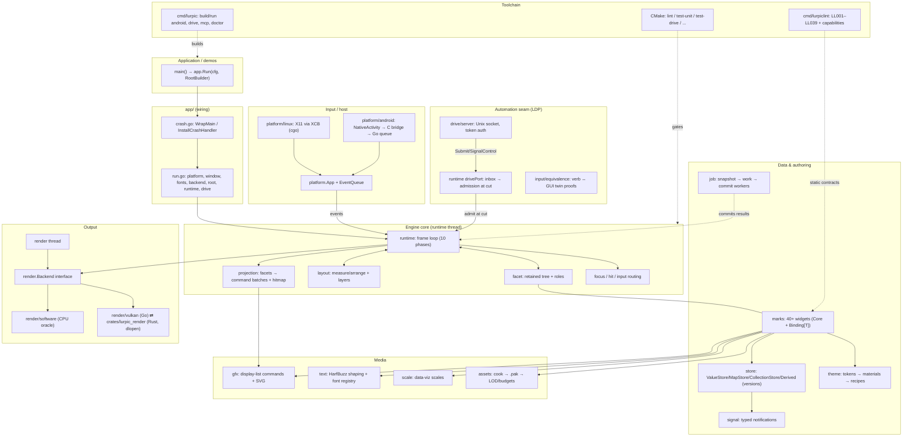
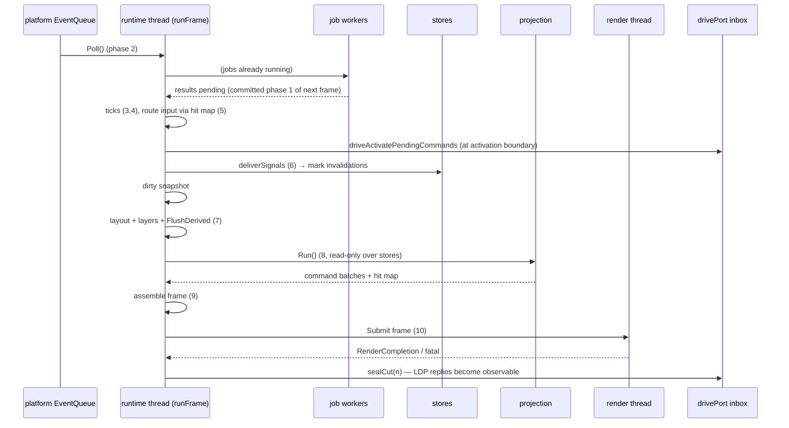
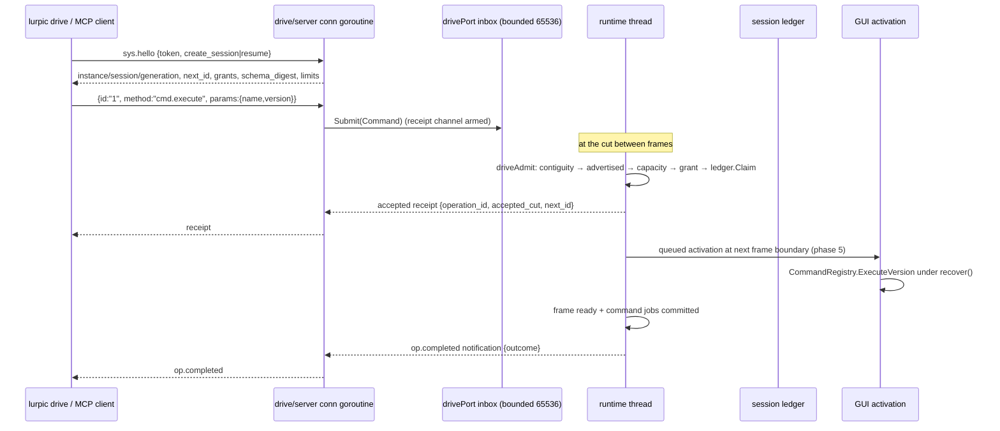
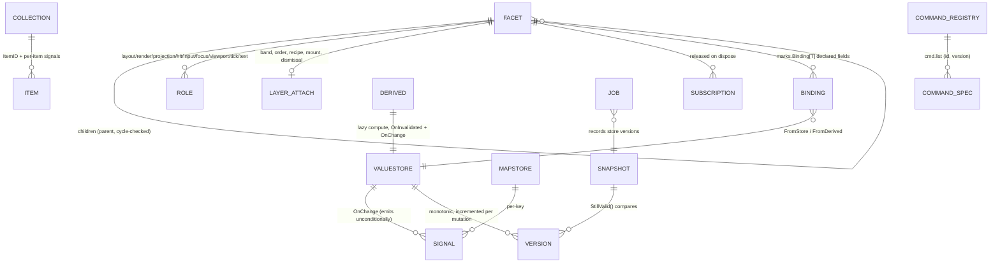

# lurpicUI — Developer Documentation

> Generated from the codebase at `/home/lex/Public/lurpicUI` (module
> `codeburg.org/lexbit/lurpicui`, Go 1.27.2+). Evidence references point at
> real files, functions, and tests. Where the code does not settle a question,
> this document says so explicitly instead of guessing.
>
> **Working-tree caveat:** at the time of writing the tree carried ~25
> uncommitted modifications concentrated in `runtime/`, `drive/`, `input/`,
> and `Documentation/drive.md` (the LDP `input.*` port). Statements that depend
> on uncommitted work are flagged inline.

---

## 1. Executive Summary

### What does this codebase do?

lurpicUI is a **retained-mode UI framework in Go** for realtime interactive
applications — mixed media, dashboards, and data visualization — targeting
**Linux desktop (X11) and Android**. It provides, end to end:

- a retained **facet tree** with a projection system (`facet/`, `projection/`),
- a layout engine with layer/overlay semantics (`layout/`),
- a widget library of **marks** (`marks/` — buttons, tables, charts, nav, …),
- a reactive **store** system as the single source of truth (`store/`),
- a frame loop with wall or virtual time (`runtime/`),
- two rendering backends — a CPU **software renderer** (also the correctness
  oracle) and a **Rust-backed Vulkan renderer** (`render/`),
- asset cooking/packaging with LOD and budgets (`assets/`),
- Android application build tooling and a CLI (`cmd/lurpic`),
- a custom static analyzer enforcing framework contracts (`cmd/lurpiclint`),
- **LDP** — an automation/actuation protocol over a Unix socket (`drive/`)
  that lets external drivers read state and actuate the GUI deterministically.

### What problem does it solve?

Building realtime UIs that must be *simultaneously* interactive for humans and
**provably drivable by machines** (tests, automation, AI agents) — without a
test-only back door that bypasses the input pipeline. The design makes every
automation verb equivalent to a real GUI gesture, proven by measurement
(`input/equivalence`), and keeps a single-writer threading model so the whole
engine stays deterministic and inspectable.

### Who are the main users or consumers?

1. **Application authors** — Go developers calling `app.Run(...)` and composing
   marks/stores (see `demos/quick_square_app`, `demos/lurpic_studio`).
2. **Framework contributors** — people extending `facet`, `runtime`, `marks`,
   `render`, `platform`.
3. **Automation drivers** — external processes speaking LDP to the app's Unix
   socket, and MCP clients through a scaffolded bridge (`lurpic mcp init`).
4. **AI coding agents** — `AGENTS.md` and `.agents/lurpiclint.md` define the
   contract they must follow (no stubs, LL038 dedup rule, CMake gates).

### The most important things a new developer should understand first

1. **One runtime thread owns everything mutable** (Principle 4,
   `Documentation/Principles/LurpicUI-FacetRuntime-Principles.md`). Store
   mutations from other goroutines panic (under the `lurpic_debug` build tag);
   background work goes through the job system's *snapshot → work → commit*
   pattern (`job/job.go`).
2. **The frame has a fixed ten-phase order** (Principle 9): jobs → platform
   events → ticks → input → signals → layout → projection → assemble → submit.
   The order is enforced by guards (`facet/projection_guard.go`,
   `store/projection.go`).
3. **Facets do not own truth** (Principles 1 and 8). Domain state lives in
   stores; facets subscribe and derive; interaction state lives in facets.
4. **Marks are the widget abstraction** built on `marks.Core` + `Binding[T]`
   (`marks/base.go`, `marks/binding.go`). Shared plumbing (fonts, icons,
   interaction state) must be used via the marks-root helpers — enforced by
   lint rule **LL038**.
5. **CMake is orchestration, Go is the source of truth** (`CMakeLists.txt`
   header). The gate for Go changes is `cmake --build build --target lint`,
   then `test-unit` (`AGENTS.md`, `CONTRIBUTING.md`).
6. **LDP is a first-class seam, not a debug hook**: grants, sessions,
   at-most-once ledger, cut boundaries, GUI-twin equivalence
   (`Documentation/drive.md`, `drive/`).

### Biggest conceptual "gotchas"

- **`scale/` is not DPI scaling.** It is a data-visualization scale library
  (linear/log/band/time scales; `scale/doc.go`). Content scale lives in
  `platform.Surface.Scale()`, `platform.Window.ContentScale()`, and
  `runtime.effectiveContentScale()` (`runtime/frame.go`).
- **Two different "equivalence" suites.** CMake target `test-equivalence`
  runs `./input/equivalence/...` (drive-verb vs GUI-gesture differential
  tests). The *render* corpus (`render/equivalence`, software vs Vulkan
  PSNR gate) has no CMake target of its own; it runs inside `test-unit`'s
  `go test ./...`.
- **`lurpic.toml` is read only by the CLI** (`cmd/lurpic/config.go`), never by
  `app`/`runtime`. Runtime configuration is Go structs + environment
  variables. Whether `[assets]` TOML values ever reach `runtime.Config` is
  **not evident from the codebase** (see §7).
- **Several CMake targets are currently broken**: `test-pure`,
  `test-headless`, `test-integration`, `bench`, `bench-graph` (and therefore
  `test-all`, `test-race`) reference deleted packages (`./graph/index/...`,
  `./marks/integration/...`) — verified: `go test ./graph/index/...` fails
  with *no such file or directory*. `test-unit` and `test-drive` are unaffected.
- **`.github/` and `devdocs/` are gitignored.** A fresh clone has *no CI
  workflows* and *none* of the working docs (including the excellent
  `devdocs/RecoverDebugLogging.md`).
- **`Documentation/README.md` does not exist**, yet `README.md:54` and
  `CONTRIBUTING.md:59` link to it (broken links).
- **`store.Set` emits unconditionally**, even when the value is unchanged;
  subscribers must dedupe (`store/value.go` doc comment).
- **LDP advertised ≠ registry.** The registry has 27 method specs; only 16 are
  `Advertised: true` (on the wire). Unadvertised methods exist for the trusted
  in-process testkit seam and return `protocol.unknown_method` on the socket.

---

## 2. High-Level Architecture

### Major layers

| Layer | Packages | Role |
|---|---|---|
| Application | `app/`, `demos/` | entry point, config wiring, platform/window selection, renderer selection, LDP startup, crash handling |
| Engine core | `runtime/`, `facet/`, `projection/`, `layout/` | frame loop, retained tree, layout/projection passes, focus/hit, layers, diagnostics |
| UI authoring | `marks/`, `theme/`, `store/`, `signal/`, `job/` | widget library, design tokens, reactive state, background work |
| Media | `gfx/`, `text/`, `icon/`, `scale/`, `assets/` | drawing grammar, shaping/fonts, icons, viz scales, asset pipeline |
| Output | `render/` (`software/`, `vulkan/` + Rust crate) | backend-agnostic frames, CPU raster, GPU pipeline |
| Input/host | `platform/` (`linux/`, `android/`, `internal/`) | event queue, surfaces, windowing, Android JNI bridge |
| Automation | `drive/` (+ `runtime/drive_*`), `input/equivalence/` | LDP protocol, socket server, read store, GUI-twin proofs |
| Toolchain | `cmd/lurpic`, `cmd/lurpiclint`, `cmake/`, `scripts/` | Android builder, linter, build/test orchestration |
| Cross-cutting | `diagnostics/`, `internal/` | telemetry model, testkit, logging, sync assertions |

### Runtime processes / threads

There is **no server process**. One process = one app instance. Goroutines:

1. **Runtime thread** — the goroutine that entered `app.Run` → `rt.Run()`
   (`runtime/lifecycle.go`). Registered via `syncutil.RegisterRuntimeThread()`.
   Sole writer of the facet tree, stores, signals, interaction state.
2. **Render thread** — `go (&renderThread{...}).run()` (`runtime/pipeline.go`);
   drains frame handoffs, runs GPU-upload budget, `backend.Submit(frame)`,
   publishes completions, performs the one-shot GPU→software fallback.
3. **Job workers** — `job.NewPool(WorkerCount)` (default `NumCPU−1`);
   execute snapshot-based jobs; results only *commit* on the runtime thread.
4. **Drive server goroutines** — one listener + per-connection goroutines
   (`drive/server/server.go`). They only `Submit`/`SignalControl` into a bounded
   inbox; **they never call app code**.
5. **Forked projection walkers** — sibling subtrees above
   `projectionForkThreshold = 8` project in parallel, merged pre-order
   (`projection/projection.go`).
6. **Asset/upload helpers** — asset decode jobs and the upload-result forwarder
   (`runtime/asset_backend.go`).

### Data flow (input → output)

```
platform event queue ──Poll()──▶ runtime thread
   jobs commit (phase 1) ───────▶ stores mutate ──signals──▶ marks invalidate
   input routed via hit map ────▶ focus/interaction state
   layout (dirty roots) ────────▶ arranged bounds
   store.FlushDerived() ────────▶ projection reads stable stores
   projection ──────────────────▶ gfx.CommandList per facet
   assembly ────────────────────▶ render.Frame (layered batches + dirty rects)
   submit ──────────────────────▶ render thread ──▶ software blit or Vulkan
```

### Architectural style

- **Layered architecture with consumer-side interfaces** at every seam that
  may vary (Principle 10): `platform.App`, `render.Backend`,
  `internal/log.Logger`, `drive.RuntimePort` are all defined in the *consuming*
  package and injected at the `app` wiring point.
- **Single-threaded actor-like core** (Principle 4) with message-passing at
  the boundaries (job results, drive inbox, render completions).
- **Not** microservices, not event-sourced, not plugin-loaded: extensions are
  compiled in Go packages, not discovered dynamically. The closest thing to a
  plugin system is the *registry* pattern (`layout.LayerRegistry`,
  `runtime.CommandRegistry`, `theme.ThemeResolver` recipe maps,
  `marks` capability index).
- The **LDP protocol** is an intentionally hard-cut, versioned wire protocol
  (major 2, no compatibility shims) with generated schema/client artifacts.

### Intentional vs accidental/legacy

| Aspect | Verdict | Evidence |
|---|---|---|
| Consumer-side interfaces (Principle 10) | intentional | `Documentation/Principles/...Principles.md` §10 |
| Advertised/unadvertised LDP split | intentional | `drive/proto/registry.go` comments, RFC D12 |
| Software renderer as GPU oracle + equivalence corpus | intentional | `render/equivalence/corpus_test.go`, `devdocs/notes/vulkan-equivalence-baseline.md` |
| CMake references to deleted `graph/`, `marks/integration/` | **accidental (rot)** | `CMakeLists.txt:233,268,302,325,431`; dirs absent |
| Broken `Documentation/README.md` links | accidental (rot) | `README.md:54`, `CONTRIBUTING.md:59` |
| `.github/`, `devdocs/` gitignored | unclear intent; CI workflows being untracked is risky | `.gitignore:13,19` |
| Committed `lurpiclint` ELF binary at repo root | almost certainly accidental | `git ls-files lurpiclint` → tracked; `/lurpic` ignored |
| Stale `devdocs/STALE/` docs (17 files) | intentional demotion | `devdocs/STALE/README.md` |
| `facet/role.go` comment "concrete role structs arrive in the next phase" | stale comment | roles exist in `facet/roles.go` |

### Textual architecture diagram



---

## 3. Repository Map

| Path | Purpose | Important Notes |
|---|---|---|
| `app/` | Application entry points & wiring: `Run()`, `Config`, renderer selection, LDP env parsing, crash handling, asset bootstrap | Build-tag split: `run_default.go` (linux) vs `run_android.go`; `drivegate_*.go` gates LDP on Android. Modified moderately (36 commits) |
| `runtime/` | The engine driver: frame loop (`frame.go`), pipeline, lifecycle, clock, focus, hit, layers, commands, diagnostics, drive port/methods | Hottest framework package (88 files, 52 test files). Fail-loud construction in `New()` |
| `facet/` | Retained tree node, lifecycle state machine, roles, subscriptions (`sub.go`), TestIDs, layer attachment, projection guard | Structural violations panic (see `facet_test.go`, `transition_test.go`) |
| `projection/` | Turns resolved layout into `gfx` command batches + hit maps; gates (empty bounds, mount, poison), cache, forked walk | Essentially one 1518-line `projection.go` + tests; "budget" is a test-time gate (`LURPIC_BUDGET_GATES=1`) |
| `layout/` | Measure/arrange system, constraints, containers, layer recipes/policies/registry, dirty propagation | Subpackages `anchor/ free/ grid/ linear/ space/ split/` are pure policy engines |
| `marks/` | Widget library: `action data feedback input navigation primitive selection status structure viz` + `contracttest/` | Most-tested dir (113 test files). `marks/` root owns shared plumbing (LL038). `doc.go` carries a PRM/BETA maturity banner |
| `store/` | Observable state: `ValueStore`, `MapStore`, `CollectionStore`, `Derived`, transactions, derived flush | Single-writer: mutations assert runtime thread (debug tag) and panic during projection |
| `signal/` | Typed `Signal[T]`, `Subscriptions` lifetime bag | Explicitly *not* concurrency-safe; emit over snapshots |
| `job/` | Job pool, priorities, frontier/ready-set, `Snapshot[T].StillValid()`, `ScheduleGuarded`, `AnyResult` | Workers restart after panic; stale commits fenced |
| `theme/` | Tokens → materials → style context → recipes → resolver; `templates/` ships themes; `recipes/` per family | `StyleContextStore` *is* a store; theme→layout bridge via `RegisterLayerLayoutRecipe` |
| `gfx/` | Lowest-level drawing grammar: sealed `Command` display list, paths, brushes, `ExpandStroke`, SVG parser (`svg/`) | Used by layout, projection, render, marks, theme, runtime. Never draws itself |
| `text/` | Font registry, HarfBuzz shaping (`go-text/typesetting`), line layout, hit-test/caret | Glyph-atlas cache key = SHA-256 prefix of font bytes+face index |
| `icon/` | Leaf package with `Resolver`/`Asset`/`CacheKey` types shared by marks and runtime | Exists to keep both import edges pointing down (Principle 10) |
| `scale/` | **Data-viz scale primitives** (linear/log/pow/time/band/zoom) + `reactive/` store integration | Pure-core: banned imports enforced by `scale/architecture_test.go` |
| `assets/` | Asset IDs (UUID), `.pak` format + mmap `PakFS`, `DevFS` hot-reload, manager/registry/budgets, `cook/` compiler, `schema/` FlatBuffers | `static-default/flowbite-icons` vendored icon set (test-only consumers found). `schema/*.fbs` + committed generated Go |
| `render/` | `Backend` interface (4 methods), texture/upload plumbing; `software/` (CPU oracle, 1468 lines), `vulkan/` (Go bridge + `crates/lurpic_render` Rust), `equivalence/` | Rust crate is dlopen'd on desktop, statically linked on Android; FFI codegen gated by `ffi_gen_test.go` |
| `platform/` | Neutral event/surface/capability/audio contracts; `linux/` (XCB via cgo), `android/` (JNI bridge + AAudio) | Linux `ContentScale()` hard-coded to 1 (no HiDPI). No desktop audio backend |
| `input/` | Event routing (pointer/key/touch/IME/focus/scroll), gesture package, **`equivalence/`** differential harness | `TestEveryEventLiteralNamesItsSource` AST gate (provenance Debt-1) |
| `drive/` | LDP: port contract, grants, sessions, ledger, `proto/` registry+codec, `server/`, `readstore/`, `locate/`, `describe/`, `schema/` (generated) | `docs_parity_test.go` keeps `Documentation/drive.md` in sync with the registry |
| `diagnostics/` | Telemetry model: `FrameStats`, `FrameLog`, `LayerSnapshot`, inspector, hit probe, overlay, panic context | Read-only snapshots; never mutates engine state |
| `cmd/lurpic/` | CLI: `build android`, `run android`, `doctor`, `drive`, `mcp init`, `logcat`, `crash`, `screenshot`, `validate demos`, `clean`, `version` | Owns `lurpic.toml` schema (`config.go`), Android templates (`androidtmpl/`), MCP templates (`mcptemplate/`) |
| `cmd/lurpiclint/` | Static analyzer: `check`, `capabilities`, `explain`, `baseline`, `verify-layout`, `drive-schema` | Rules LL001–LL039 in `internal/rules/` (LL005–LL009 unused) |
| `cmake/`, `CMakeLists.txt`, `CMakePresets.json` | Build orchestration: Go wrappers, toolchain detection, presets, packaging | `project(... LANGUAGES NONE)`; Go stays the source of truth |
| `scripts/` | `drive-gate` (LDP gate manifest runner), `perf-diff.sh`, lint drift scripts | `scripts/lint/*` and `scripts/test-lint/` are currently not wired to CMake or CI |
| `internal/` | `testkit` (headless harness, goldens, `Drive*` helpers), `log`, `syncutil`, `fontdata`, `hashutil`, `renderutil`, `perfscene` | Private; `internal/testkit` is the main test-authoring surface |
| `demos/` | `quick_square_app` (smoke demo, has `lurpic.toml`), `lurpic_studio` (capability gallery, 82 files, no `lurpic.toml`) | Studio is the de-facto integration testbed and LDP golden source |
| `Documentation/` | **Canonical** tracked docs: `drive.md` (parity-tested), `Principles/*` | `Documentation/README.md` is *missing* but linked from README/CONTRIBUTING |
| `devdocs/` | Working notes/plans/drafts (`RecoverDebugLogging.md`, book draft, drive RFCs, `STALE/`) | **Gitignored** — invisible to git and to fresh clones |
| `.github/` | CI workflows `ci.yml`, `android.yml` | **Gitignored** (`git ls-files .github` is empty) — a fresh clone has no CI |
| `.agents/` | `lurpiclint.md` cheat sheet for AI agents | Tracked |
| `.tools/flatbuffers/` | Vendored `flatc` binary | Gitignored; no `go:generate` invocation found — codegen appears manual |
| `vendor/` | Go module vendor tree | Gitignored; `go mod vendor` once; builds fail loudly on drift |
| `build/` | CMake build tree (binaries, go-cache, drive-evidence) | Gitignored; `lurpic clean` deletes it |
| root binaries | `lurpiclint` (tracked ELF!), `lurpic` (ignored), `*.test` (ignored) | `lurpiclint` at root being tracked is almost certainly accidental |

Naming/layout conventions: per-file `x.go` + `x_test.go`; contract tests named
`*_contract_test.go`, golden tests `*_golden_test.go`, integration tests for
marks `*_integration_test.go`; `testdata/` per package; build-tag gating
(`android`, `lurpicdrive`, `lurpic_debug`, `cgo`).

---

## 4. Core Concepts and Domain Model

### 4.1 Facet — the retained node

- **Plain English:** a node in the retained UI tree. It observes state, owns
  ephemeral interaction/presentation state, and projects into a local spatial
  form. It never owns domain data (Principle 1).
- **Where:** `facet/facet.go` (`type Facet`), lifecycle in
  `facet/lifecycle.go` (`Created → Attached → Active → Inactive → Disposed`),
  transitions in `facet/transition.go`.
- **Relations:** a facet has children, roles, dirty flags
  (`DirtyLayout | DirtyProjection | DirtyHit`), subscriptions (`facet/sub.go`),
  and an optional `LayerAttachment` (`facet/layer_attach.go`).
- **Example** (from `demos/quick_square_app/main.go`): a root type embeds
  `facet.Facet`, adds a `facet.LayoutRole` and `facet.RenderRole`, and returns
  it from the `RootBuilder`.
- **Invariants (panic, not error):** `AddChild` after attach, cycles,
  double-parenting, `BindImpl` called twice with different impls,
  `AddRole` after attach, duplicate roles, `Invalidate` after dispose — all in
  `facet/facet.go`.
- **Easy to misunderstand:** `AddChild` (construction-time) vs
  `AddChildRuntime` (post-attach structural mutation) — they are different
  code paths on purpose.

### 4.2 Roles — participation, not identity (Principle 6)

- **Where:** `facet/role.go` (sealed `Role` interface with unexported methods —
  *external packages cannot implement roles*), concrete roles in
  `facet/roles.go` + `facet/layout_role.go`.
- Key roles: `LayoutRole` (`OnMeasure`/`OnArrange`), `RenderRole.OnCollect`
  (immediate-mode draws for non-projected facets), `ProjectionRole.OnProject`
  (the mark drawing path — must run inside projection phase or it panics via
  `facet/projection_guard.go`), `HitRole`, `InputRole`, `FocusRole`,
  `ViewportRole`, `TextRole`, `TickRole.OnTick`.
- **Relations:** the frame pipeline invokes *roles* across the tree; a facet
  with no roles is a valid structural container.

### 4.3 Store — single source of truth (Principle 2)

- **Plain English:** observable state cells with monotonic versions.
- **Where:** `store/value.go` (`ValueStore[T]`), `store/map.go`, `store/collection.go`,
  `store/derived.go` (`Derived[T]`, lazy + `Peek`), `store/transaction.go`
  (stage → commit/rollback), `store/flush.go` (`FlushDerived()` runs before
  projection each frame), `store/version.go`.
- **Invariants:** mutations assert the runtime thread
  (`syncutil.AssertRuntimeThread`, active under `lurpic_debug && !android`),
  panic during projection (`store/projection.go`), and **emit unconditionally**
  — even no-op `Set` calls notify subscribers. Versions increment on every
  mutation; job snapshots record versions to detect staleness
  (`job.Snapshot.StillValid`).
- **Example:** `demos/lurpic_studio/studio/status_bar.go` wires
  `marks.FromDerived(notConnected, facet.DirtyProjection)` and
  `marks.FromStore(feed.JobProgress, facet.DirtyLayout|facet.DirtyProjection)`.

### 4.4 Signal / Subscriptions

- `signal.Signal[T]`: `Subscribe → HandlerID`, `Unsubscribe`, `Emit` over a
  handler snapshot; not concurrency-safe by contract (delivery is serialized by
  the frame loop via `store.SetSignalQueueHook(rt.queueSignal)`).
  `signal/lifetime.go` provides the `Subscriptions` bag released on facet
  dispose.

### 4.5 Job — background work (Principle 5)

- **Pattern:** snapshot (runtime thread, captures store versions) → work
  (worker computes on the snapshot) → commit (runtime thread validates
  versions; stale → discard).
- **Where:** `job/job.go` (`Pool`, `Priority Interactive|Background`,
  `Frontier`, `ReadyThrough`, `Pause/Resume`), `job/anyjob.go` (`BindJob`
  with `OwnerID/OnCommit/AfterCommit`), `job/anyresult.go`.
- **Relations:** results drain at frame phase 1 (`runtime/frame.go:
  drainJobResults`); facets receive them via `ProjectionRole.OnJobResult`.
  Command-owned jobs are fenced by the owning LDP session generation.

### 4.6 Mark — the widget abstraction

- **Plain English:** a reusable UI component (Button, Table, Tabs, Axis…)
  built by composing `marks.Core` with typed `Binding[T]` fields and roles.
- **Where:** contract in `marks/mark.go` (`Mark = FacetImpl + Descriptor()`),
  base machinery in `marks/base.go` (reflection over exported `Binding[T]`
  fields — *"the struct declaration is the entire binding contract"*),
  bindings in `marks/binding.go` (`Const`, `FromStore`, `FromDerived`),
  two-way contract in `marks/value.go` (`ScalarBinding`: attach-sync,
  re-sync, write-back, echo guard).
- **Example constructor pattern** (see `marks/primitive/text.go`): embed
  `marks.Core`, declare `Binding` fields, set `Layout.Parent/Child` contracts,
  set `BuildCommands`, call `t.RegisterRoles(t)`, add extra roles, implement
  `Base()` and `Descriptor()`.
- **Gotchas:** binding fields may be reassigned any time **before attach**;
  `AddBinding` is mark-internal (lint **LL037** bans external calls);
  scroll-capable marks must call `EnableViewport()`; content invalidation must
  route through `layout.PropagateContentDirty` (content vs structure rule,
  `layout/propagation.go`).
- **Families:** `marks/{action,data,feedback,input,navigation,primitive,
  selection,status,structure,viz}` — 40+ marks; `lurpiclint capabilities`
  prints the live index (note: generic constructors like `viz.NewLine[T]` are
  absent from the index because the scanner keys on `func NewX(...)`).

### 4.7 Projection — broader than rendering (Principle 3)

- **Plain English:** each facet turns its arranged bounds + subscribed state
  into a local interactive spatial form: draw commands, hit regions, child
  coordinate contexts, selection geometry.
- **Where:** `projection/projection.go` (`System.Run`), gates: empty-bounds
  prune (FR-1), mount gate (Q4), cache keyed on bounds+transform+viewport+
  `SubscribedVersions`, poison skip. Fork threshold 8, pre-order merge.
- **Invariant:** `facet/projection_guard.go` panics if `Project`/`Collect`
  runs outside the projection phase ("frame pipeline order (RX-1 P5)").

### 4.8 Layout & layers

- Two-pass measure/arrange over dirty roots (`layout/system.go`); constraints
  in `layout/space/constraints.go` (`Tight/Loose/Unconstrained`).
- **Content vs structure** (`layout/propagation.go`): content changes route to
  `NearestLayoutRoot` via `PropagateContentDirty`; structural changes (child
  set/order) are explicit host code.
- **Layers:** overlays/split panes are ordered bands
  (`Base < Content < Popover < Modal < Tooltip < Toast` in `facet/layer_attach.go`)
  with an immutable **layer registry** (standard layers 1–9, orders
  1000…9000; `layout/layer_registry.go`). Recipes
  (`modal|grid|free|anchor`, `layout/layer_recipe.go`) resolve through the
  theme resolver first (`theme.ThemeResolver.RegisterLayerLayoutPolicy`-style
  maps in `theme/resolver.go`). Mount gate: an unmounted layer child is
  skipped entirely (stats `LayersUnmountedSkips`).

### 4.9 Theme

- **Pipeline:** `Tokens` (`theme/tokens.go`) → `Material` (`material.go`) →
  `MarkStyle.Resolve(state, tokens)` (`style.go`) → family recipes
  (`theme/recipes/*` via `RecipeResolver[T]`/`SlotPatch[T]`) →
  `ResolvedContext` (`resolver.go`) → layout recipe lookup for layers.
- `StyleContext` is itself a store (`StyleContextStore`), derived via
  `ctx.Derive(override)` with `Depth++`.

### 4.10 Clock, frame, cut, epoch

- **Wall vs virtual** (`runtime/clock.go`): wall = monotonic mapping of real
  time; virtual = frozen, single-stepped only by LDP `time.advance`/`frame.run`.
  Mode switch refused during a gesture (`ErrClockGestureActive`).
- **Frame epoch** increments once per full pipeline run; **cut** is the
  boundary between frame N's submit (phase 10) and frame N+1's phase 1 —
  sealed by `drivePort.sealCut(frame)`. All LDP mutations apply at a cut.
- Pacing uses a *separate* monotonic wall clock (`FrameTimer.SetPacingClock`)
  — it must never be the logical engine clock.

### 4.11 LDP vocabulary

- **Instance / session / generation:** each launch gets a random
  `InstanceID`; `sys.hello` creates or resumes a session; each connection
  attach bumps the generation and fences the previous one.
- **Grants:** `read, input, command, time, admin` — immutable per session
  (`drive/grants.go`). The v1 `write` grant does not exist.
- **Ledger:** bounded at-most-once outcome store (1024 entries / 4 MiB,
  `drive/ledger.go`); IDs admitted **contiguously**; retained → replay,
  changed payload → `request.conflict`, evicted → `request.expired`.
- **Command registry:** the app's public mutation surface for `cmd.execute`
  (`runtime/commands.go`) — IDs must match `^[a-z0-9.]+$`, positive version,
  collision-free (all panics at registration).
- **TestID:** automation addressing (`facet/testid.go`); unique while live,
  duplicate live IDs panic (QP-7).

### 4.12 State taxonomy (Principle 8) — the confusion magnet

| Kind | Lives in | Examples | Test |
|---|---|---|---|
| Domain | stores | graph structure, metrics, records | would losing it force re-entry/re-fetch? |
| View | stores | zoom, sort mode, filters | would losing it force re-configuration? |
| Interaction | facet internals / runtime | hover, drag, focus, gesture | unnoticeable after interaction ends? |
| Render | projection internals | glyph cache, dirty rects | reconstructible from domain+view? |

---

## 5. Application Flow and Request Lifecycle

### 5.1 Startup / initialization

**Trigger:** `main()` calls `app.Run(cfg, builder)` (`app/run.go:177`).

1. `normalizeConfig` (window defaults 800×600).
2. `wireDriveEnv(&config)` — the *only* `LURPIC_DRIVE` parse site
   (`app/drive.go`); runs the Android drive gate; creates
   `drive.NewInstance()` + `drive.NewSessionTable()` + shared `drive.Stats`.
3. Clock guard: virtual startup requires the `time` grant; `runtime.PrepareClock`
   runs **before** the root builder so builders see a stable `EngineClock`.
4. Platform app: `newPlatformApp()` (build-tag: `linux.NewApp` /
   `android.NewApp`) — unless `cfg.PlatformApp` injected.
5. Window vs surface: desktop `platform.WindowCapableOf` → `NewWindow` +
   `window.Surface()`; Android `surfaceProvider` with a 15s event-pump wait
   (`surfaceWaitTimeout`) to avoid deadlocking on the `WindowCreated` side effect.
6. Font registry (`Path` XOR `Data` per source).
7. `initBackend(...)`: preference Vulkan (default) → env
   `LURPIC_RENDER_BACKEND` wins → Android shortcut when the surface reports
   zero Vulkan extensions → honest pipeline probe
   (`BuildPipelineProbe()`, FR-11) → software retry if the surface is a
   `SoftwareSurface`.
8. Theme context + font-role validation.
9. `builder(BuildContext{...})` → root facet (nil → error).
10. Runtime config completion (font registry, theme resolver, layer registry,
    asset manager, software fallback factory).
11. `runtime.New` — fail-loud validation; installs drive port iff
    `Config.Drive.Enabled`.
12. If drive enabled: `startDriveServer` (socket under
    `$XDG_RUNTIME_DIR/lurpic-<pid>/drive.sock`, 32-byte hex token) — only after
    `rt.DrivePort()` exists.
13. Diagnostics hook + `cfg.OnRuntime(rt)` (post-build wiring: named stores…).
14. `primeRuntime` → `RunOneFrame()` → `window.Show()` → `rt.Run()`
    (shutdown via `defer rt.Shutdown()`).

**Failure points:** returned as wrapped errors from `app.Run` (init class,
Principle 11). Examples: missing root facet, invalid
`LURPIC_RENDER_BACKEND`, virtual clock without time grant, unresolvable layer
recipe (panics in `validateLayerRecipes` at `runtime.New`), drive socket path
already existing (startup failure, never blind-unlinked).

### 5.2 The frame (main request-handling path)

Canonical phase list (Principle 9, `Documentation/Principles/...` §9) matches
the code in `runtime/frame.go:runFrame`:

| # | Phase | Code | Notes |
|---|---|---|---|
| 1 | Drain job results | `drainJobResults()` | ordered drain (`DrainOrdered`) in virtual mode |
| — | GPU upload drain | `UploadQueue.DrainBudget()` results | budgeted texture uploads |
| 2 | Collect platform events | `collectPlatformEvents()` + `handleWindowEvents` | LDP human-preemption scan happens here |
| 3 | Tick hover | `inputSystem.TickHover(now)` | |
| 4 | Tick active facets | `tickFacets(dt)` → guarded `TickRole.OnTick` | |
| 5 | Deliver input | layered hit map → `input.Deliver` per event | drive activation boundary: `driveActivatePendingCommands()` runs here (one command per frame) |
| 6 | Deliver signals | `deliverSignals()` | ≤16 batches then panic (cycle detector) |
| — | Dirty snapshot | `copyDirtyFacets()` + optional `DirtySnapshotSink` | captured *before* phases 7/8 mutate dirty state |
| 7 | Layout (dirty roots) | `runLayoutPass(windowSize)` → `resolveLayerTree()` | includes anchor export, layer measure/arrange, focus rebuild, `store.FlushDerived()` |
| 8 | Projection | `projectionSystem.Run(root, FrameInfo)` under `projectionInProgress` guard | |
| 9 | Assemble | `assembleWindowFrames` → layered batches, dirty regions, overlay injector | |
| 10 | Submit | `SubmitAndWait` (sync) or `SubmitReserved` (async + frame credit) | logs `LURPIC_FIRST_FRAME` on frame 1 |
| — | Seal | `drivePort.sealCut(frameNumber)`, `diag.OnFrame(stats)`, clear dirty sets | cut advances here |



**Where it can fail:** render submit errors → `fatalCh` → `Run()` returns
`runtime: render failure`; `render.ErrGPUFatal` → one-shot swap to software
(`runtime/fallback.go`); facet callback panics → quarantine (`recovery.go`).

### 5.3 LDP request lifecycle (external call path)



Failure modes: `protocol.malformed` / `protocol.line_limit` /
`protocol.version_mismatch` (rejected *before* admission, ID not consumed);
`request.gap` (non-contiguous ID); `request.conflict` (same ID, changed
payload); `request.expired` (evicted); `grant.denied`; `capacity.busy`;
`input.busy`; `input.preempted` (human took over mid-gesture);
`protocol.unknown_method` (unadvertised). Handler panics → typed
`internal.panic` result, app keeps rendering.

**Debugging:** `lurpic drive ping`, `lurpic drive --check` (schema-digest
skew), `--session-file` to reuse a 0600 credential, `op.status` after a lost
completion; runtime side: `FrameStats.DriveCommandsDrained` (the "E5 drive
row"), `LURPIC_DEBUG_RUNTIME_LOOP=1` trace, `drive.SocketGoroutinePanics`
counter.

### 5.4 Background jobs & events

- Jobs scheduled from any goroutine via `job.Pool`/`Runtime.Schedule`; results
  drain in phase 1 on the runtime thread; asset completions likewise
  (`AssetLoadJob` → `DrainCompleted()`).
- Platform events (IME, vsync, lifecycle, Android configuration changes) all
  arrive through `platform.EventQueue` and are handled in
  `runtime/input.go:handleWindowEvents`.
- Signals (store notifications, bindings) queue and are delivered in phase 6,
  cycle-capped at 16 iterations.

### 5.5 Data persistence

There is **no database**. Persistence is: cooked `.pak` archives + a UUID
path registry (`assets/uuid_registry.json`) at build time; crash reports as
text files (`~/.lurpic/crashes/`); LDP session files (0600) for CLI resume;
golden PNGs under `testdata/`. See §8.

### 5.6 Shutdown / cleanup

`rt.Shutdown()` (idempotent) → close `shutdownCh` → `superviseShutdown`
cancels jobs → shutdown hooks → `disposeTree` **under frameMu write lock** →
job pool shutdown → release style subs → `renderPipeline.destroy()` +
destroy backend → clear global hooks. Android lifecycle: `OnPause` pauses +
cancels jobs, `OnSurfaceLost` stops submission (frames still tick),
`OnLowMemory` clears caches + `runtime.GC()`. Drive: server `Close()`,
socket/token files left for operator cleanup (never blind-unlinked).

---

## 6. Public APIs and Interfaces

There are **no HTTP/REST/GraphQL endpoints** — the process is a desktop/Android
app. The externally visible APIs are: the Go application API, the LDP socket
protocol, the two CLIs, and the in-process extension interfaces.

### 6.1 Application API (`app` package)

| Symbol | Purpose | Notes |
|---|---|---|
| `app.Run(cfg Config, builder RootBuilder) error` (`app/run.go:177`) | boot everything and run the frame loop | returns init errors; `defer rt.Shutdown()` inside |
| `app.DefaultConfig(title, w, h) Config` (`app/config.go:89`) | sane defaults (Vulkan, 60fps runtime config) | |
| `Config{Window, Runtime, Fonts, Theme, PlatformApp, Render, OnBackendSelected, Diagnostics, Drive, OnRuntime}` | full startup config | `Drive` is env-populated; zero value ignored |
| `BuildContext{FontRegistry, Clock, WindowSize, ContentScale, Theme}` | what the root builder receives | |
| `app.Asset(path)` | bootstrap-only whole-file read (>1 MiB warns) | Android reads from APK via `AAssetManager` |
| `app.WrapMain(fn)`, `app.InstallCrashHandler()` | outer panic/signal defense | composes with runtime's inner quarantine |
| `runtime.DiagnosticsHook` (`OnFrame(FrameStats)`) + optional structural sinks (`DirtySnapshotSink`, `backendFallbackSink`, `overlayInjector`) | diagnostics wiring | widened *by assertion*, not by interface change |

### 6.2 Key runtime/facet APIs used by apps

| API | Location | Purpose |
|---|---|---|
| `facet.FacetImpl` interface (`Base()`, attach/detach/activate/deactivate) | `facet/transition.go` | what every facet/mark implements |
| `AddRole`, `AddChild`, `AddChildRuntime` | `facet/facet.go` | structure (panics on violations) |
| `facet.Subscribe(mark).Collect(...)` / `facet.Store(...)` | `facet/sub.go` | nil-safe subscriptions, version-tracked |
| `layout.PropagateContentDirty(f, rt, source, flags)` | `layout/propagation.go` | the *correct* content invalidation route |
| `runtime.Runtime`: `Schedule/CancelJob`, `Invalidate`, `RequestFrame`, `RegisterNamedStore`, `SetFocus`, `LastFrameStats`, `LayerSnapshots`, `HitTrace` | `runtime/core.go`, `control.go`, `layers_runtime.go` | engine services exposed to the app |
| `runtime.CommandRegistry.Register(CommandEntry)` | `runtime/commands.go` | public mutation surface (`cmd.list`/`cmd.execute`) |

### 6.3 LDP wire API (Unix socket, NDJSON)

Transport: UTF-8 NDJSON, one object per line, **4 MiB max line**, nesting ≤ 32,
strict decode (duplicate keys / unknown envelope fields / non-canonical IDs
rejected without consuming a request ID). Identifiers that carry uint64
precision are decimal strings. Full normative reference:
`Documentation/drive.md` (kept honest by `drive/docs_parity_test.go`, which
passes: `go test -run TestDocsMatchRegistry ./drive/` → ok).

**Advertised methods (16) — the major-2 wire surface**
(source of truth: `drive/proto/registry.go`):

| Method | Grant | Mutating | Purpose | Params (shape) | Result (shape) |
|---|---|---|---|---|---|
| `sys.hello` | — | no | version/instance/session negotiation | `token`, `create_session` *or* `resume{instance_id, session_id, resume_credential}`, `client_name` | `instance_id, session_id, [resume_credential], connection_generation, next_id, grants, schema_digest, limits` |
| `sys.ping` | read | no | liveness tied to a sealed cut | — | pong with sealed cut + last submitted frame |
| `cmd.list` | read | no | enumerate GUI-backed commands | — | specs `{id, version, title, category, ...}` |
| `cmd.execute` | command | **yes** | run a registered command | `{name, version}` (exact contract version) | receipt `{operation_id, state:"accepted", accepted_cut, accepted_frame, next_id}` → later `op.completed` notification |
| `op.status` | — | no | retained outcome of own operation | `{operation_id}` | state/outcome or `operation.expired` |
| `input.click/press/release/move/drag/type/scroll/focus` | input | **yes** | GUI-backed synthetic input through the real platform queue | verb-specific (e.g. `target`, coordinates, `text`, gesture handles) | accepted receipt → `op.completed` with `{consumed_atoms}` (uncommitted work in the tree; see caveat below) |
| `time.mode` | time | **yes** | acquire/release virtual-time lease | `{mode:"virtual"\|"wall"}` | completes after the transition frame is ready |
| `time.advance` | time | **yes** | advance engine time one frame | `{duration_ns:"1"…"1000000000"}` | completes when exactly one frame is ready |
| `frame.run` | time (+ union of plan grants) | **yes** | bounded ordered plan | command-only plan: `cmd.execute` steps + bounded frame tail + registered `then` reads | completes after final submitted frame is ready |

**Unadvertised (11, trusted in-process seam only):** `sys.info`,
`locate.resolve`, `tree.dump`, `store.list`, `store.read`, `derived.read`,
`facet.query`, `frame.pixels`, `frame.packet`, `sub.watch`, `sub.cancel`.
They are implemented or partially implemented on the runtime side
(`runtime/drive_methods.go` dispatches 24 handlers; `sub.watch`/`sub.cancel`
have **no handler anywhere**) but are *not* on the wire: a socket caller gets
`protocol.unknown_method`.

**There is no `store.write`** — direct store mutation was deleted, not hidden
(`drive_readstore_test.go:TestStoreWrite_Absent`).

⚠️ **Caveat (working tree):** the `input.*` methods were flipped to
`Advertised: true` in the uncommitted diff; the accepted-receipt →
`op.completed` flow for `input.*` is not yet described in
`Documentation/drive.md`, and the S4 acceptance tests named in
`devdocs/plans/lurpic-drive-protocol-v2.md` do not exist yet.

### 6.4 `lurpic` CLI

| Command | Purpose | Key flags / notes |
|---|---|---|
| `lurpic build android` | Go+Rust cross-compile, manifest, dex, assets, sign APK/AAB | `--release --aab -o --keystore --ks-alias --ks-pass --sdk-path --ndk-path --abi --project`; release gates: `target_sdk ≥ 35`, `min_sdk ≥ 21`, `arm64-v8a` present |
| `lurpic run android` | build + install + launch + logcat | `--emulator --device --avd --gpu --force-software --no-logcat` |
| `lurpic doctor [android]` | toolchain diagnostics | non-zero exit if `CanBuild()` false |
| `lurpic drive <verb>` | LDP client | verbs: `ping`, `--check`, `commands`, `execute`, `op-status` (+ `--socket --token-file --session-file --name --version --operation-id`) |
| `lurpic mcp init <app> --schema <path> --out <dir>` | scaffold an MCP bridge module | `--out` required; parse-level validation only |
| `lurpic logcat / crash / screenshot` | device diagnostics | `crash` pulls tombstones + `ndk-stack`; `screenshot --golden --diff` compares **file sizes only** (documented limitation) |
| `lurpic validate demos` | runs marks + demo test suites (not TOML validation, despite the name) | |
| `lurpic clean` / `lurpic version` | delete `build/` / print version | |

⚠️ `main.go` usage text still lists nonexistent verbs `watch, resolve, tree`
and omits `commands, execute, op-status`.

### 6.5 `lurpiclint` CLI

| Command | Purpose |
|---|---|
| `lurpiclint check [--format text\|json\|github] [--fail-on error] [--baseline f] [--config .lurpiclint.toml] [packages]` | run all rules; exit 0/1/2/3 = clean/findings/usage/internal |
| `lurpiclint capabilities [--format text\|json]` | the "uxauthoring index": marks, layouts, layers, fingerprints |
| `lurpiclint explain LL0nn` | rule rationale + fix |
| `lurpiclint baseline generate [-o path]` | regenerate baseline JSON |
| `lurpiclint verify-layout [-builder B] [-size 1280x800] <pkg>` | structural layout checks (`empty-bounds`, `measured-not-arranged`, `sibling-overlap`, `child-out-of-parent`) |
| `lurpiclint drive-schema [--out drive/schema]` | regenerate LDP `schema.json` + typed Go client (drift-gated in CI) |
| `lurpiclint version` | |

Rules (**LL001–LL039**, LL005–LL009 unused) live in
`cmd/lurpiclint/internal/rules/`; notable errors: LL003 (hand-rolled
containers), LL010 (`facet`/`projection` importing `render`), LL011
(goroutines in facet code), LL014/LL018/LL021 (overlay contract), LL016
(store mutation in measure/arrange), LL023 (reactive binding overwritten),
LL029–LL033 (capability without `contracttest` assert), LL037 (`AddBinding`
outside `marks/`), LL038 (re-declared runtime providers), LL039 (duplicate
TestID). Suppression: `//lurpiclint:ignore LLxxx -- reason`.

### 6.6 In-process extension interfaces

| Interface | Defined in | Implementations |
|---|---|---|
| `render.Backend` (`Initialize/Submit/Resize/Destroy`) | `render/render.go` | `render/software`, `render/vulkan`, testkit fake; optional `CacheEvictor`, `RecreatableBackend`, `DeviceGenerationProvider`, `TextureBackend` |
| `platform.App` / `EventQueue` / `Surface` + capability structs (`WindowCapable`, `ClipboardCapable`, `IMECapable`, `LifecycleCapable`, `AudioCapable`) | `platform/` | `platform/linux`, `platform/android`, `internal/testkit` |
| `drive.RuntimePort` (`Submit`, `SignalControl`, `Observe`, …) | `drive/port.go` | `runtime.drivePort` |
| `assets.AssetSource` (`ReadLOD`), `assets.Manager` | `assets/job.go`, `manager.go` | `PakFS`, `DevFS`, `PackAssetSource` |
| `assets/cook.Compiler` (`Extensions`, `Compile`) | `assets/cook` | SVG, Font, Image, Config compilers |
| `layout.LayerLayoutPolicy` | `layout/layer_policy.go` | anchor / free / grid policies |
| `internal/log.Logger` | `internal/log/log.go` | `*slog.Logger` (satisfies structurally), `NopLogger`, `NewStderrLogger()` |
| `marks` providers (duck-typed): `FontRegistry()`, `IconResolver()`, `ResolveIcon()` | probed via `marks.ShaperFor`, `marks.IconResolverFrom`, `marks.ResolveIconFrom` | implemented by `runtime.Runtime`; re-declaring them in `marks/*` is LL038 |

---

---

## 7. Configuration and Environment

### Config files

| File | Read by | Purpose |
|---|---|---|
| `<project>/lurpic.toml` | **only** `cmd/lurpic` (`config.go:loadConfig`, searched upward from cwd) | app identity, Android packaging, asset budgets |
| `~/.config/lurpic/config.toml` (or `$XDG_CONFIG_HOME/...`) | `cmd/lurpic/user_config.go` | machine-level toolchain paths |
| `.lurpiclint.toml` | `cmd/lurpiclint` (auto-discovered; **none exists in this repo today**) | `fail_on`, per-rule severity, path excludes, capability roots |
| `lurpiclint-baseline.json` | `lint-lurpiclint` target | grandfathered findings (currently **1 entry**, an LL012 in `marks/data/join_test.go`; stores an **absolute host path**, so it only matches on this machine) |
| `assets/cook.toml` | `assets/cook` | asset cooking manifest |
| `CMakePresets.json` | CMake | configure/build presets (`host-tests`, `dev-*`, `ci-*`, `release-*`) |

**`lurpic.toml` schema** (all keys, from `cmd/lurpic/config.go`):

```toml
[app]
id        = "org.example.app"   # required, Android-applicationId shape
name      = "My App"             # required
version   = "1.0.0"              # semver major.minor.patch (each 0..999)
icon      = ""                   # optional single icon path
main      = "."                  # Go package to cross-compile (must not escape project)

[android]
min_sdk = 24                     # default 24; release requires >= 21
target_sdk = 36                  # default 36; release requires >= 35
version_code = 0                 # default derived: major*1e6 + minor*1e3 + patch
abis = ["arm64-v8a"]             # release must include arm64-v8a

[android.permissions]
required = []
optional  = []

[android.keystore]
path  = ""                       # release only; password NEVER stored here
alias = ""

[android.sdk]   # path + version pin        (same shape for [android.ndk], [android.jdk])

[android.assets]
no_compress = ["*.pak"]          # default: mmap'd zero-copy
# [[android.assets.packs]] name/delivery = install_time|fast_follow|on_demand  (Play Asset Delivery)

[assets]
residency_mode = "auto"          # auto | cpu | gpu
cpu_budget_mb = 256
gpu_budget_mb = 192
upload_budget_kb_frame = 4096
```

⚠️ **Unclear wiring:** `[assets]` values are validated by the CLI, but no code
transporting them into `runtime.Config.AssetsResidencyMode` /
`AssetCPUBudgetMB` etc. was found. The runtime defaults are hardcoded in
`runtime.DefaultConfig()` (`"auto"`, 256 MB, 192 MB, 4096 KB/frame). Either
the app author must copy them into `app.Config.Runtime` manually, or the
wiring is missing. Evidence needed: a call site mapping TOML → `runtime.Config`.

⚠️ `toolchain.go` error text suggests a `lurpic config set ...` command that
does not exist. `config.go` declares a dead `IconConfig` type.

### Environment variables

| Name | Required | Default | Used by | Description |
|---|---|---|---|---|
| `LURPIC_DRIVE` | no | off | `app/drive.go:parseDriveEnv` | `off` / `on[:grants]` / `unix:/abs/d.sock[:grants]`; default grant `read`; unknown grants (incl. v1 `write`) fail startup |
| `LURPIC_RENDER_BACKEND` | no | `vulkan` (cfg) | `app/run.go:initBackend` | `vulkan` \| `software`; highest precedence; invalid value = startup error |
| `LURPIC_ASSETS_PAK` | no | `./assets.pak` | `app/run.go:initAssetManager` | use a `.pak` (PakFS) instead of a directory |
| `LURPIC_ASSETS_DIR` | no | `./assets` | same | dev filesystem with fsnotify hot-reload |
| `LURPIC_CRASH_DIR` | no | `~/.lurpic/crashes` → temp | `app/crash.go` | crash report directory |
| `LURPIC_DEBUG_RUNTIME_LOOP` | no | off | `runtime/debug_trace.go` | `LURPIC_RUNTIME_TRACE:` per-frame stderr trace |
| `LURPIC_TRACE` | no | off | `projection/debug_trace.go` | `gates` → gate-decision trace (≤64 lines/frame) |
| `LURPIC_ASSET_DIAGNOSTICS` | no | off | `runtime/asset_diag.go` | per-event asset mount/extract/stream/evict logs |
| `LURPIC_BUDGET_GATES` | no | off | budget tests | `1` enables layout/projection timing gates (CMake `test-budget`) |
| `LURPIC_SUITE_BUDGET` | no | `150` | `lurpic-host-tests` target | suite wall-clock budget (seconds) |
| `LURPIC_FFI_REGENERATE` | no | off | `render/vulkan/ffi_gen_test.go` | `1` rewrites FFI codegen instead of failing |
| `LURPIC_RENDER_RUST_LIBRARY` | no | crate target dir | `render/vulkan/ffi_linux.go` | override `liblurpic_render.so` path |
| `LURPIC_VALIDATION_LAYER_DIR` | no | — | Vulkan tests | validation layers |
| `LURPIC_SKIP_VSYNC` | no | off | `platform/android` | `1` disables Choreographer vsync |
| `LURPIC_SKIP_ANDROID_PAK` | no | off | `app/run_android.go` | skip APK `.pak` extraction (dev) |
| `LURPIC_ANDROID_AVD` / `ANDROID_AVD_NAME` | no | managed name | `cmd/lurpic/emulator.go` | emulator AVD name |
| `LURPIC_KEYSTORE_PASSWORD` | no | — | `cmd/lurpic/android_builder.go` | release signing password (never in TOML) |
| `LURPIC_SEED` | no | — | `demos/lurpic_studio/main.go` | seed dataset for determinism harness |
| `LURPICUI_UPDATE_GOLDEN` | no | — | `internal/testkit/golden.go` | regenerate golden images (`-update-golden` flag wins) |
| `TESTKIT_GOLDEN_DEBUG` | no | — | `internal/testkit` | golden diff debugging |
| `LURPIC_VERIFYLAYOUT_OUT` | no | — | `lurpiclint verify-layout` | findings output path (internal) |
| `XDG_RUNTIME_DIR` | drive on Linux | — | `app/drive.go` | default socket parent; **missing = drive start error** |
| `ANDROID_HOME`/`ANDROID_SDK`, `ANDROID_NDK_HOME`/`NDK_HOME`, `JAVA_HOME` | Android builds | auto-detect paths | `cmd/lurpic/sdk.go` | toolchain (precedence: flags > project TOML > user TOML > env > auto) |

**Missing/invalid config behavior:** `lurpic.toml` missing → CLI walks upward
and errors *"no lurpic.toml found"*; invalid app id → validation error;
`LURPIC_RENDER_BACKEND` invalid → startup error; drive grants unknown →
startup failure; missing `XDG_RUNTIME_DIR` with drive on → error. Runtime
constructors are fail-loud (`runtime.New` panics/returns on bad
`TargetFPS`, nil font registry, bad named stores, unresolvable layer recipes).

**Safe to change:** window title/size, `TargetFPS`, asset budgets, renderer
choice, token palettes/themes, TestIDs.
**Dangerous:** layer registry order/IDs (hit-test and focus-trap semantics),
command IDs/versions (the LDP mutation contract), store threading assumptions,
frame phase order, `lurpic_debug` assertions' behavior, baseline edits
(burn-down accounting), anything under `runtime/frame.go`.

---

## 8. Data Model and Persistence

### No database

There is **no DB, queue, or cache server**. All application state is
in-process, memory-only, and versioned:



### Store types & access patterns

| Type | File | Pattern |
|---|---|---|
| `ValueStore[T]` | `store/value.go` | `Get()` any goroutine; `Set/SetTx` runtime thread only; unconditional emit |
| `MapStore[K,V]` | `store/map.go` | per-key signals |
| `CollectionStore[T]` | `store/collection.go` | `Insert/Remove/Update/Replace(+Tx)`, O(1) `Get`, `ItemID` reconcile, snapshot copies |
| `Derived[T]` | `store/derived.go` | lazy, `Peek` never recomputes (LDP QP-9), `OnInvalidated` coalesces clean→dirty |
| `Transaction` | `store/transaction.go` | stage → `Commit`/`Rollback`, atomic under concurrency |

**Validation:** type-level (generics) plus runtime asserts (thread, phase).
**Transactions:** only the store transaction primitive — there is no
distributed/DB transaction concern.

### Persistence that *does* exist

1. **Assets: `.pak` archive** (`assets/pak.go`). Layout: 32-byte header
   (`Magic, Version, TOCOffset, TOCCount, DepsOffset, DepsCount`) → 48-byte TOC
   entries (`AssetID [16]byte` UUID, offset, sizes, LOD, type, compression:
   `None|LZ4|Zstd`) → dependency table → aligned payloads. `PakFS` mmaps it
   (`syscall.Mmap`) and binary-searches TOC by the first 8 bytes of the UUID.
   Deterministic output; SHA-256 sidecar `assets.pak.meta` gates Android
   re-extraction.
2. **UUID path registry** — `assets/uuid_registry.json` generated by
   `assets/cook.UUIDRegistry`; cooked and runtime *must* share
   `CanonicalizePath` or lookups silently miss (`assets/manager.go` doc).
3. **FlatBuffers schemas** — `assets/schema/cfnt.fbs` (font metrics),
   `assets/schema/csg.fbs` (vector shapes); generated Go committed under
   `assets/schema/lurpic/...` (zero-copy reads asserted in
   `schema_test.go`). Regenerated manually with the vendored `flatc`
   (`.tools/flatbuffers/`; no `go:generate` found).
4. **Crash reports** — `crash_<ts>.txt` in `LURPIC_CRASH_DIR`/`~/.lurpic/crashes`.
5. **LDP session files** — 0600 JSON credentials for CLI resume.
6. **Golden images** — `testdata/golden/<platform>/` (545 PNGs on disk; note:
   `marks/**/testdata/` and `demos/lurpic_studio/studio/testdata/` are
   **gitignored**, so fresh clones lack those goldens).

**"Migrations"** in the asset sense = cook (compile) → pack; there are no
schema migrations for app data. **Do not hand-edit:** `*.pak`,
`uuid_registry.json` (generated), `drive/schema/schema.json` +
`drive/schema/gen/client.go` (generated by `lurpiclint drive-schema`, drift
gated), `assets/schema/lurpic/**` (generated), `ffi_linux.c` FFI blocks
(regenerated by `TestFFISymbols_InSync`).

### Asset pipeline lifecycle

```
source (.svg/.ttf/image/.toml) → assets/cook Compiler (per-platform LODs)
  → UUID registry → Packer → assets.pak (+ .meta)
  → runtime Manager (PakFS/DevFS) → ReadLOD → decode → registry state
  → CPU/GPU budget caches → ResolveDrawable → gfx command → upload queue
```

Residency policy (`assets/policy.go`): SVG → always CPU (vector re-rasterized
at draw size); images/fonts may be GPU-resident; budgets LRU-evicted;
device-generation bump invalidates GPU texture IDs.

---

## 9. External Services and Integrations

There are no cloud/third-party SaaS integrations. The "external systems" are
platform and toolchain boundaries:

| Service | Purpose | Code location | Config | Failure handling |
|---|---|---|---|---|
| **X11/XCB (Linux windowing)** | window, events, SHM surface, clipboard, keysyms | `platform/linux/internal/display/display_cgo.go` (`#cgo pkg-config: xcb xcb-shm xcb-icccm xcb-keysyms`), `linux_nocgo.go` fallback | display from `DISPLAY` | connection errors surface at `NewApp`; non-cgo build compiles a fallback |
| **Android NativeActivity + JNI** | lifecycle, input, surface, config, vsync, audio focus | `platform/android/internal/bridge/lurpic_android.c` + `bridge_android.go` (Go exports), Java `cmd/lurpic/androidtmpl/LurpicNativeActivity.java` | manifest generated by builder; `lurpicdrive` build tag | callbacks push to `EventQueue`; missing surface → 15s wait → startup error |
| **Vulkan driver** | GPU rendering | `render/vulkan` (Go) ⇄ `render/vulkan/crates/lurpic_render` (Rust, `ash`+`gpu-allocator`), dlopen via `ffi_linux.c`, static on Android | `LURPIC_RENDER_BACKEND`, `LURPIC_RENDER_RUST_LIBRARY`; honest probe `BuildPipelineProbe()` | init failure → software retry; `ErrGPUFatal` → one-shot software swap; other fatal → `fatalCh` shutdown |
| **Rust toolchain / cargo-ndk** | build `liblurpic_render.so` | `render/vulkan/toolchain.go`, CMake `build-render-vulkan-rust`, `lint-rust-clippy` | pinned crates vendored | build failures fail CMake targets |
| **Android SDK/NDK/JDK, aapt2, d8, apksigner, zipalign, bundletool** | APK/AAB pipeline | `cmd/lurpic/android_builder.go`, `sdk.go`, `toolchain.go` | flags > TOML > user config > env > autodetect | each tool error wraps with *"Run 'lurpic doctor'"* |
| **adb / emulator** | install, logcat, screenshots, drive socket forwarding | `cmd/lurpic/run.go`, `emulator.go`, `diagnostics.go` | `--device`, `--emulator`, `LURPIC_ANDROID_AVD` | boot timeout (default 5m), device-count ambiguity → error |
| **Lurpic Drive Protocol socket** | external automation | `drive/server`, `app/drive.go`, client `cmd/lurpic/drive_locate.go` | `LURPIC_DRIVE` | see §5.3; token rotation = app restart; stale socket/token = startup failure (operator cleans) |
| **MCP (Model Context Protocol)** | expose LDP as agent tools | `cmd/lurpic/mcp.go` + `mcptemplate/` (uses `github.com/modelcontextprotocol/go-sdk`) | generated module's `go.mod` | ⚠️ scaffold emits **v1** wire (`{"v":1,...}`) and rejects non-v1 hellos — incompatible with the v2 server; golden test is stale (6 tools vs 14). Treat as unfinished |
| **Go module proxy / vendor** | deps | `go.mod` (11 direct deps) | network or `go mod vendor` | build fails loudly on vendor/`go.mod` drift |

**Local testing:** LDP — run the app with `LURPIC_DRIVE=on` and use
`lurpic drive ping`; equivalence — `cmake --build build --target
test-equivalence`; Vulkan — offscreen readback in
`render/equivalence` (no window needed) or the CI fixture SDK
(`cmake/Fixtures/VulkanSDK`); Android — `lurpic run android --emulator`
(CI does this on macOS-14).

**Adding an integration:** implement the consumer-side interface (Principle 10)
in a new package, wire it at the `app` layer (or `cfg.OnRuntime`), and add a
testkit fake for tests. Never reach into `runtime` internals from the new
package — depend on the interface you consume.

---

## 10. Building Applications on Top of This Codebase

### Intended extension points

1. **Compose marks** (`marks/*`) with stores/bindings — the 99% path.
2. **Write a custom mark** (`marks.Core` + `Binding[T]` + roles).
3. **Raw facets + roles** for bespoke visuals (see `quick_square_app`).
4. **Register commands** (`runtime.CommandRegistry`) for palette + LDP
   actuation — but only after `cfg.Runtime.CommandRegistry` is set (see
   How-to 1; a nil registry silently drops registrations).
5. **Register named stores** (`cfg.OnRuntime` → `RegisterNamedStore`) for LDP
   read access.
6. **Theme customization**: tokens, `SlotPatch` overrides, recipe resolvers,
   `RegisterLayerLayoutRecipe`.
7. **Layer registry** customization (`layout.LayerRegistryBuilder`) — custom
   overlay bands, focus traps, dismissal.
8. **Asset cooking**: implement `assets/cook.Compiler` for a new source type.
9. **Render backend** (`render.Backend`) — new output target.
10. **Platform backend** (`platform.App`) — new OS.

**Do not:** mutate stores off the runtime thread; spawn goroutines in facet
code (LL011); call `ProjectionRole.Project` outside the projection phase;
hand-roll containers (LL003) or `LayoutRole` plumbing (LL001) when a mark
exists; re-declare font/icon providers in marks (LL038); call `AddBinding`
outside `marks/` (LL037); bypass the input pipeline for automation (use LDP).

### How-to 1 — Add a new API-ish surface: a GUI-backed application command

**Goal:** expose an app action to both the command palette and LDP
(`cmd.list`/`cmd.execute`).

**Files to modify:** your app package (registration), optionally a facet for
palette UI.

**Steps:**

1. **Wire a `CommandRegistry` into the runtime config before `app.Run`.**
   Neither `app.DefaultConfig` (`app/config.go:89`) nor `runtime.DefaultConfig()`
   (`runtime/config.go:125`) creates one — `runtime/config.go:52` is only the
   nil-able field:

   ```go
   cfg := app.DefaultConfig("My app", 1280, 800)
   cfg.Runtime.CommandRegistry = runtime.NewCommandRegistry()
   ```

   Skipping this fails **silently on the GUI side**: `Register` runs
   `AssertRuntimeThread()` and then returns on a nil receiver
   (`runtime/commands.go:68-72`), so registrations issued from `cfg.OnRuntime`
   disappear with no panic and an empty palette. The LDP side is loud instead:
   `cmd.list` and `cmd.execute` return `ErrCommandUnavailable` —
   `"no command registry configured"` (`runtime/drive_methods_cmd.go:24-27,
   63-66`). All fail-loud `Register` panics (bad ID, version 0, empty title,
   duplicate ID) only apply **once a registry exists**.
2. Register from `cfg.OnRuntime` (runtime thread only — `Register` asserts).
   `rt.CommandRegistry()` is just `rt.config.CommandRegistry`
   (`runtime/core.go:280`), i.e. whatever you set in step 1:

```go
cfg.OnRuntime = func(rt *runtime.Runtime) {
    rt.CommandRegistry().Register(runtime.CommandEntry{
        ID:       "demo.recenter",   // ^[a-z0-9.]+$
        Version:  1,                  // positive contract version, bump on behavior change
        Title:    "Recenter view",
        Category: "View",
        Execute:  func() { centerView.Store(true) }, // must mutate stores legally (runtime thread)
    })
}
```

3. Drive it externally: `LURPIC_DRIVE=on:read,command` + `lurpic drive commands`
   (`cmd.list` needs the **read** grant, `drive/proto/registry.go:59`) and
   `lurpic drive execute --name demo.recenter --version 1` (**command**
   grant, `:60`), then
   `lurpic drive op-status --operation-id <id>` if completion is lost.

**Tests:** unit-test `Execute` effects through stores; integration via
`internal/testkit` (`NewStandardHarness`) or `internal/testkit.DriveHarness`
calling `cmd.execute`; LDP path covered by the `cmd.execute` equivalence twin
(`cmd.execute/palette`).

**Common mistakes:** skipping step 1 (nil registry → `Register` is a silent
no-op, empty palette and an LDP `no command registry configured` error);
building the palette on a **different** registry than
`cfg.Runtime.CommandRegistry` (`action.NewCommandPalette(label, registry, open)`
takes the registry explicitly — the LDP surface only ever sees
`rt.CommandRegistry()`); ID with uppercase/`_` (panic), version 0 (panic),
empty title (panic), registering twice (panic); executing mutations from a
non-runtime goroutine; changing behavior without bumping `Version` (drivers
pin exact versions); `LURPIC_DRIVE=on,read,command` — grants are separated
from `on` by **`:`**, not `,` (`app/drive.go:71-79` rejects `on,read,command`
at startup).

### How-to 2 — Add a new mark (UI component)

**Goal:** a reusable widget, e.g. a `TemperatureBadge`.

**Files:** `marks/<family>/temperature_badge.go` + `_test.go` +
`_integration_test.go` + `testdata/` goldens.

**Steps:**

1. Declare bindings and roles:

```go
type TemperatureBadge struct {
    marks.Core
    Value marks.Binding[float32]   // store-backed
    Scale marks.Binding[string]    // "C"|"F"
    // interaction state lives here, not in stores (Principle 8)
    hover bool
    // ...private roles
}

func NewTemperatureBadge(v marks.Binding[float32]) *TemperatureBadge {
    b := &TemperatureBadge{Value: v, Scale: marks.Const("C")}
    b.Facet = facet.NewFacet()
    b.Layout.Parent = facet.GroupParentContract{Kind: facet.GroupLayoutNone, Overflow: facet.OverflowClip}
    b.Layout.Child  = facet.GroupChildContract{/* intrinsic size + constraint policy */}
    b.Layout.OnMeasure = /* measure using bindings */
    b.Layout.OnArrange = /* record ArrangedBounds */
    b.BuildCommands = func(ctx facet.ProjectionContext) []gfx.Command { return b.build(ctx) }
    b.RegisterRoles(t)      // ← wires ProjectionRole from BuildCommands + subscribes declared bindings
    return b
}

func (b *TemperatureBadge) Base() *facet.Facet { b.BindImpl(b); return &b.Facet }
func (b *TemperatureBadge) Descriptor() marks.Descriptor {
    return marks.Descriptor{Family: "status", TypeName: "temperature_badge"}
}
```

2. Use shared plumbing only through marks-root helpers:
   `marks.ShaperFor(rt)`, `marks.ResolveIconFrom(rt, ref)`,
   `marks.IconCommands(...)`, `marks.InteractionStateFor(...)`
   (**LL038** enforces this).
3. Route content invalidation with `layout.PropagateContentDirty`
   (bindings do this automatically when declared); declare
   `DirtyLayout` on bindings whose size changes (see the studio status bar
   comment).
4. If it declares capabilities (`Focusable`, `Accessible`, `DataBound`,
   `AnchorExporting`, `KeyedItem`, `HostsChildren`), you **must** add
   contract tests using `marks/contracttest` asserts (**LL029–LL033**).
5. If it differs across interaction states, ensure it is discriminable
   (`marks/state_conformance_test.go` exemption table) and style via
   `MarkStyle`/theme tokens, not hardcoded colors (**LL028** for viz).

**Tests:** `NewStandardHarness(t, w, h, mark)` + `DriveClickAt`/`DriveType`
interaction tests, `AssertGolden` pixel tests (run `-update-golden` once — mark
goldens are gitignored!), `contracttest` asserts.

**Common mistakes:** assigning binding fields after attach; storing domain
state in the mark; forgetting `EnableViewport()` for scrollables; manual
`AddBinding`; hardcoding fonts/colors; registering no `LayoutRole` while
embedding `facet.Facet` with children (**LL019**).

### How-to 3 — Connect an external service / build an automation client

**Goal:** let an outside process observe state and actuate the app safely.

**Steps:**

1. **Enable LDP:** launch the app with `LURPIC_DRIVE=on:read,command` (or
   `unix:/path:read,command`). Socket + token appear under
   `$XDG_RUNTIME_DIR/lurpic-<pid>/drive.sock` (printed as
   `drive: socket=... grants=... instance=...`).
2. **Expose state:** register named stores so drivers can read them:

```go
cfg.OnRuntime = func(rt *runtime.Runtime) {
    rt.RegisterNamedStore(readstore.NamedStore{Name: "feed", Store: feedProgress})
}
```

(Custom descriptor adaptation: set `cfg.Runtime.DescribeMark =
drivedesc.Describe` as the studio does, enabling kind/role/name/key lookup.)

3. **Consume it:**
   - quickest: `lurpic drive ping`, `lurpic drive --check` (digest skew),
     `lurpic drive commands`, `lurpic drive execute ...`, `--session-file`
     for cross-process resume;
   - MCP: `lurpic mcp init myapp --schema drive/schema/schema.json --out ./bridge`
     then implement/verify the handshake (**warning:** the current template
     speaks protocol v1 and will be rejected by a v2 server — verify before
     relying on it);
   - custom Go client: use `drive/proto` for the envelope
     (`ProtocolMajor = 2`) and mirror `cmd/lurpic/drive_locate.go` (dial →
     `sys.hello` with `create_session` → monotonic decimal string IDs →
     `op.status` recovery).
4. **Security:** keep the parent dir 0700 / socket+token 0600 (the server
   enforces and fails startup on pre-existing paths); grant least privilege
   (`read` only is the default).

**Tests:** `internal/testkit.NewDriveHarness(t)` for in-process port tests;
`drive/v2_socket_test.go` patterns for socket-level tests; the equivalence
corpus for any new mutating verb (**every mutating method must declare a
`Twin`** — enforced by `input/equivalence/coverage_test.go`).

**Common mistakes:** retrying under a *new* request ID after a lost receipt
forbidden — resume the same ID; assuming `input.*` retries are safe (a human
preempts → `input.preempted`, handle it); expecting unadvertised reads
(`store.read`, `facet.query`) on the wire.

### How-to 4 — Build and ship an Android app

**Goal:** package your Go app as a debuggable APK.

**Steps:**

1. Create a project dir with `lurpic.toml` (see §7) and `cmd/<app>/main.go`
   calling `app.Run`.
2. One-time: `lurpic doctor android` (SDK/NDK/JDK, `cargo-ndk`, system image).
3. `lurpic build android --project <dir> -o out.apk` (debug builds add the
   `lurpicdrive` tag → LDP available; release builds never get it and refuse
   `LURPIC_DRIVE` at startup).
4. `lurpic run android --emulator` (or `--device <serial>`) → install, launch
   `org.lurpicui.bridge.LurpicNativeActivity`, stream logcat; grep for
   `LURPIC_FIRST_FRAME`.
5. Release: `lurpic build android --release --keystore ... --ks-alias ...`
   → gates: `target_sdk ≥ 35`, `min_sdk ≥ 21`, `arm64-v8a` present, debug
   symbols zip, `zipalign -P 16` + `apksigner` + verify. `--aab` for Play.

**Tests/verification:** CI's `android.yml` cross-compiles, smoke-builds an
APK, lints `aapt2 dump badging`, and boots an emulator asserting
`LURPIC_FIRST_FRAME` + tap liveness + no `FATAL EXCEPTION`.

**Common mistakes:** missing `lurpic.toml` (search walks up and fails);
`target_sdk < 35` for release; forgetting `uuid_registry.json` (asset lookups
silently miss); expecting the drive socket off-device (use
`adb forward`).

---

## 11. API Usage Examples

### Minimal example — a window that draws

Runnable as-is (`go run ./demos/quick_square_app` is exactly this, minus the
error print). This is the smallest complete application:

```go
package main

import (
    "fmt"
    "os"

    "codeburg.org/lexbit/lurpicui/app"
    "codeburg.org/lexbit/lurpicui/facet"
    "codeburg.org/lexbit/lurpicui/gfx"
)

func main() {
    cfg := app.DefaultConfig("My App", 800, 600)
    cfg.Render = app.RenderBackendSoftware // deterministic; default is Vulkan
    if err := app.Run(cfg, buildRoot); err != nil {
        fmt.Fprintf(os.Stderr, "Error: %v\n", err)
        os.Exit(1)
    }
}

type root struct {
    facet.Facet
    layout facet.LayoutRole
    render facet.RenderRole
}

func buildRoot(ctx app.BuildContext) facet.FacetImpl {
    r := &root{}
    r.layout = facet.LayoutRole{
        OnMeasure: func(c facet.MeasureContext, k facet.Constraints) facet.MeasureResult {
            return facet.MeasureResult{Size: k.MaxSize}
        },
    }
    r.render = facet.RenderRole{
        OnCollect: func(list *gfx.CommandList, bounds gfx.Rect) {
            list.Add(gfx.FillRect{Rect: bounds, Brush: gfx.SolidBrush(gfx.Color{R: .1, G: .12, B: .16, A: 1})})
        },
    }
    r.AddRole(&r.layout)
    r.AddRole(&r.render)
    return r
}
```

Note: a raw `LayoutRole` with no mark triggers lurpiclint **LL001** (warn) —
suppress intentionally (`//lurpiclint:ignore LL001 -- reason`) or use marks.

### Reactive example — stores + derived + mark bindings

```go
// State (lives in stores; may be mutated only on the runtime thread).
progress := store.NewValueStore(0.0)            // float32 zero value
ready    := store.NewDerived(func() bool { return progress.Get() >= 1.0 }, progress)

// In a mark construction (bindings assigned before attach):
bar.Value   = marks.FromStore(progress, facet.DirtyLayout|facet.DirtyProjection)
badge.Label = marks.FromDerived(readyText, facet.DirtyProjection) // projection-only: no re-layout

// Anywhere on the runtime thread (e.g. inside a command Execute or a
// committed job result):
progress.Set(0.42) // emits OnChange unconditionally — subscribers must dedupe
```

Evidence for the sizing rule: `demos/lurpic_studio/studio/status_bar.go`
documents that a binding changing text width must declare `DirtyLayout` so
`layout.PropagateContentDirty` re-measures through the nearest layout root.

### Error-handling example

```go
func main() {
    if err := app.WrapMain(run); err != nil {   // outer defense: panic → error + crash report
        fmt.Fprintln(os.Stderr, err)
        os.Exit(1)
    }
}

func run() error {
    cfg := app.DefaultConfig("My App", 1280, 800)
    cfg.Logger = log.NewStderrLogger()          // slog to stderr; default is silent
    cfg.Diagnostics = myFrameSink                // implements runtime.DiagnosticsHook
    return app.Run(cfg, buildRoot)
}
```

- Facet-callback panics are handled **inside** the runtime: the facet subtree
  is quarantined ("poisoned"), logged once
  (`facet quarantined after panic`), counted in `FrameStats.PoisonedFacets`,
  and the rest of the app keeps running (`runtime/recovery.go`).
- Init failures return from `app.Run`. Render fatals return
  `runtime: render failure` (unless `ErrGPUFatal` triggered the software swap).
- Set `cfg.Runtime.RecoveryDisabled = true` in tests/benchmarks to see the
  original panic with attribution.

### Advanced example — deterministic scripted session (in-process harness)

```go
h := testkit.NewStandardHarness(t, 1280, 800, mark) // headless app + backend
h.DriveClickAt(x, y)     // warmup frame runs first (first-frame hitmap is nil)
h.DriveKeyPress(key)
h.DriveType("hello")
testkit.AssertGolden(t, h.Image(), "my_mark/typing.png") // -update-golden to create
```

Out-of-process equivalent: enable `LURPIC_DRIVE=on:time`, then
`time.mode=virtual` → `time.advance {duration_ns:"16666667"}` per frame →
`frame.run` for an ordered command plan. The determinism contract is tested by
`drive/determinism_test.go:TestDeterminism_VirtualReplay` (1000 frames,
frame-packet hashes compared run-to-run).

### Connecting this system to another service (sketch)

Pattern used by the studio: background ingestion → store on commit → UI
subscribes; external control via LDP.

```go
// 1. Job (background): snapshot → work → commit
snap := job.SnapshotOf(progress)               // records store versions
pool.Schedule(job.PriorityBackground, snap, func(s job.AnySnapshot) job.AnyResult {
    v := fetchFromSomewhere()                  // slow, no store access here
    return job.ResultOf(v)
}) // commit happens in frame phase 1; stale versions → dropped

// 2. External agent: speak LDP (or scaffold MCP)
//    LURPIC_DRIVE=on:read,command ./myapp
//    lurpic drive execute --name feed.refresh --version 1
```

### Building a small feature end-to-end (checklist)

1. Model state as stores (`store.NewValueStore`/`CollectionStore`).
2. Build UI from marks, bind with `marks.FromStore`/`FromDerived`.
3. Expose user intents as `CommandRegistry` entries (palette + LDP free —
   once `cfg.Runtime.CommandRegistry` is wired; see How-to 1).
4. Do slow work in jobs with `job.Snapshot` versioning.
5. Add contract tests (`marks/contracttest`) + golden + integration test.
6. Run `cmake --build build --target lint` and `test-unit`.

---

## 12. Extension and Customization Guide

### Mechanisms

| Mechanism | How it works | Where |
|---|---|---|
| **Consumer-side interfaces** (Principle 10) | interface declared where used; concrete impl injected at `app` wiring; compile-time test fakes | `render.Backend`, `platform.App`, `drive.RuntimePort`, `log.Logger` |
| **Structural capability probes** | type assertion, never registration: `Descriptor()` flags, `capabilities.go` interfaces (`Focusable`, `Accessible`, …), optional diagnostics sinks | `marks/descriptor.go`, `marks/capabilities.go`, `runtime/config.go` |
| **Reflection over declared fields** | `marks.Core.declareBindings` scans exported `Binding[T]` fields per type (cached); `RegisterRoles(self)` wires roles once | `marks/base.go` |
| **Registries (freeze-once)** | `layout.LayerRegistryBuilder` (`.Freeze()` → immutable, uniqueness enforced), `runtime.CommandRegistry` (fail-loud `Register`, except a nil receiver which
   no-ops), `theme.ThemeResolver` recipe maps, `assets` path registry | `layout/layer_registry.go`, `runtime/commands.go`, `theme/resolver.go` |
| **Build-tag gates** | `android`, `lurpicdrive`, `lurpic_debug`, `cgo` select implementations; release Android never compiles LDP | `platform/android/drivegate_*.go`, `app/run_*.go` |
| **Env-var seams** | renderer choice, drive enablement, traces, asset source | §7 |
| **Generated artifacts** | `lurpiclint drive-schema` (schema + typed client), FFI inventory codegen, `go:embed` templates | `drive/schema/`, `render/vulkan/ffi_gen_test.go` |

### Contracts extensions must obey

1. **Threading:** store mutation only on the runtime thread; no goroutines in
   facet code (LL011); background work via jobs.
2. **Phase discipline:** `ProjectionRole.Project` / `RenderRole.Collect` only
   during projection; no store writes in `OnMeasure`/`OnArrange` (LL016) or
   `OnProject` (LL035).
3. **Provider dedup:** use `marks.ShaperFor` / `marks.IconResolverFrom` /
   `marks.InteractionStateFor`; never redeclare (LL038, `AGENTS.md`).
4. **Overlay contract:** overlays need layer registration, hit policy,
   dismissal, mount path (LL014/LL018/LL021) and must not be both a layer
   child and a group child (LL034).
5. **Capability tests:** declaring a capability requires its `contracttest`
   assert (LL029–LL033).
6. **Command surface:** `^[a-z0-9.]+$` IDs, positive versions, no collisions.
7. **LDP:** mutating verbs need a `Twin` in the equivalence corpus; the wire
   registry only advertises implemented methods.
8. **No forbidden imports:** `facet`/`projection` must not import `render`
   (LL010); `marks` cannot import `unsafe`/`os`/`net`
   (`marks/architecture_test.go`); `scale` is pure-core
   (`scale/architecture_test.go`).

### Internal — do not use directly

- `runtime.drivePort` internals and `drive_*` admission helpers (use
  `drive.RuntimePort` / registry metadata).
- `projection` internal caches and fork partitioning.
- `internal/*` (Go visibility forbids it anyway — except `internal/testkit`
  from within the module, which is the sanctioned test surface).
- `marks.Core.AddBinding` (LL037), raw `facet.Facet` structural mutation
  post-attach without `AddChildRuntime`.
- Generated files listed in §8.

### How extensions are discovered/loaded

There is **no runtime plugin loader**. Discovery is compile-time: you import
the package; capabilities are found by type assertion; the
`lurpiclint capabilities` index is generated by AST scan
(`cmd/lurpiclint/capabilities`), not registration.

### Testing extensions

- Unit: pure policy packages (layout subpackages, scale) are table-driven.
- Integration: `testkit.NewStandardHarness` + `Drive*` helpers + goldens.
- Contract: `marks/contracttest.Assert*` (enforced by linter).
- Static: `lurpiclint check ./...` (this is the primary gate for extensions).
- For new LDP surface: extend `input/equivalence` corpus + regenerate schema.

### Safe extension checklist

- [ ] Uses consumer-side interface; wired at `app` layer, not inside `runtime`.
- [ ] No store mutation off the runtime thread; no goroutines in facet code.
- [ ] Content invalidation via `PropagateContentDirty`/declared bindings;
      structural changes explicit.
- [ ] Marks use `marks.*` provider helpers only; contract tests added for every
      declared capability.
- [ ] No hardcoded fonts/colors (theme tokens/materials).
- [ ] Goldens updated (`-update-golden`) and reviewed visually.
- [ ] `lurpiclint check ./...` clean (or reasoned `//lurpiclint:ignore` with a
      justification).
- [ ] `cmake --build build --target lint` and `test-unit` pass.
- [ ] New mutating LDP verbs (if any) ship with twin + corpus entry + schema
      regeneration.
- [ ] No changes to phase order, layer registry semantics, or ledger/ID
      admission rules unless that is the explicit goal.

---

## 13. Important Design Principles

The authoritative statement is
`Documentation/Principles/LurpicUI-FacetRuntime-Principles.md` (14
principles). Key ones with code evidence:

| Principle | Meaning | Code evidence | Tradeoff |
|---|---|---|---|
| 1. Facets own translation, not truth | facets derive from stores; never hold domain data | Principle 1 test (swap-the-facet test); LL012 flags domain fields in facets | more store/binding boilerplate |
| 2. Stores are the single source of truth | single writer, versions, typed signals | `store/value.go` asserts, `store/version.go`, `job.Snapshot` versions | version bookkeeping everywhere |
| 3. Projection ⊃ rendering | projection emits commands + hit + selection; renderer is a consumer | `facet`/`projection` must not import `render` (LL010, enforced) | extra indirection (command lists) |
| 4. Runtime thread owns mutable state | one writer; everything else uses snapshots/messages | `syncutil.AssertRuntimeThread`, `frameMu`, job drains | slow work must be jobs |
| 5. Concurrency accelerates projection, not the model | snapshot→work→commit only | `job/job.go`, `ScheduleGuarded` stale fences, forked projection merged pre-order | no ad-hoc goroutines allowed |
| 6. Roles define participation | pipeline invokes roles, not type switches | `facet/roles.go`, sealed `Role` interface | roles cannot be added externally |
| 7. Children project in parent context | layer/viewport coordinate worlds | `facet/screen_to_local.go`, layer recipes, propagation rules | overlays need explicit layer setup |
| 8. Four kinds of state | domain/view in stores; interaction in facets; render in caches | Principles §8; studio code comments | requires discipline; LL012/LL026 guardrails |
| 9. Fixed phase order | 10 phases, batched invalidations | `runtime/frame.go` ordering + guards | mid-phase side effects forbidden |
| 10. Interfaces at varying seams, consumer-side | testkit/platform/backend pluggability | `render.Backend`, `platform.App`, `drive.RuntimePort` | wiring spread across `app` |
| 11. Errors classified, not uniform | panic = contract violation; wrapped = init; discard = recoverable; `fatalCh` = system | `runtime/recovery.go`, `app/crash.go`, drive typed errors | panics are intentional in hot paths |
| 12. Observable but not magic | explicit subscriptions, named invalidation sources, typed signals | `InvalidateWithSource`, `DirtySnapshot.LastInvalidatedBy`, `diagnostics/` | verbose `OnAttach` wiring |
| 13. Assets demand-loaded/budgeted | handles vs memory ownership | `assets/cache.go`, `UploadQueue` budgets, residency policy | eviction complexity |
| 14. Actuation is the fourth seam | LDP obey the same rules: typed, fail-loud, GUI-twin proven | `input/equivalence`, `drive/registry.go` `Twin` field | every verb is doubled; automation slower |

**Where complexity is intentionally hidden:** stroke expansion
(`gfx.ExpandStroke` shared by CPU and GPU), rasterization behind the display
list, FFI trampolines behind `render.Backend`, reflection-based binding
registration, layer recipe resolution behind the theme resolver.

**Coupling:** low across seams (interfaces), *high within* the frame loop by
design (phases are ordered and mutually dependent). `runtime` imports nearly
everything — it is the composition root of the engine, so changes there ripple.

**Repeated patterns:** fail-loud constructors; `testdata` + contract tests;
consumer-side interfaces; registries with freeze/validate; optional
capabilities via type assertion rather than interface growth; env-var gated
debug traces; parity/drift tests for generated or documented surfaces
(`TestDocsMatchRegistry`, `TestSchemaDrift`, `TestFFISymbols_InSync`,
`agents-md-drift.sh`).

**Anti-patterns / risky areas:** the frame loop file (`frame.go`) is a
long ordered procedure that everything hangs off; duplicated enums across
`facet/` and `layout/` (e.g. `PlacementMode`, `ClipPolicy`, `HitPolicy`,
`DismissalScope`) with subtly different constant sets; `marks.ShaperFor`
allocates a fresh shaper per call (marks disagree on caching — verify intent);
stale comments (`facet/role.go`, `registry.go:146` digest prefix).

---

## 14. Error Handling, Validation, and Edge Cases

### Classification (Principle 11)

| Kind | Mechanism | Examples |
|---|---|---|
| Contract violation | **panic** with actionable message | `facet: AddChild after attach`; `runtime: command ID "X" is invalid`; store mutation during projection; `Project` outside phase 8; duplicate live TestID |
| Init failure | wrapped error from `app.Run` | no root builder, bad `LURPIC_RENDER_BACKEND`, drive env invalid, virtual clock without time grant, socket path exists |
| Recoverable runtime | discard/log, continue | poisoned facet subtree skipped everywhere (layout, projection, tick, hit); asset load failure counted in `FrameStats`; `input.preempted` |
| System failure | recovery path then shutdown | `render.ErrGPUFatal` → one-shot software swap; other submit errors → `fatalCh` → `Run()` returns error; signal cycle panic after 16 batches |

### Where validation happens

- **Construction:** `runtime.New` (FPS, registries, named stores, layer
  recipes), `CommandRegistry.Register` (once a registry exists — a nil
  receiver returns silently), `layout` registry `Freeze`,
  `lurpic.toml` load + release validation.
- **Per frame:** phase guards, mount gates, empty-bounds prune, poison skip,
  focus trap sync.
- **At the LDP boundary:** strict NDJSON decode (duplicate keys, unknown
  envelope fields, non-canonical IDs, non-object params, nesting > 32,
  non-finite/overflowing numbers, trailing data) — all rejected *before*
  admission so no request ID is consumed; then contiguity, advertised,
  capacity, grant, ledger checks on the runtime thread.
- **Static:** the entire `lurpiclint` rule set (§6.5) + golangci-lint +
  test-side AST gates (`architecture_test.go`, `source_gate_test.go`,
  `docs_parity_test.go`).

### Error surfacing to consumers

- LDP: typed `proto.Error` codes (40 defined in `drive/proto/envelope.go`),
  e.g. `protocol.malformed`, `protocol.version_mismatch`, `request.conflict`,
  `request.expired`, `grant.denied`, `capacity.busy`, `input.busy`,
  `input.preempted`, `operation.expired`, `locator.unresolved`,
  `instance.changed`. Retryability flagged (`NonAdmitted`, `Retryable`).
- App: errors returned from `app.Run`; crash reports written for signals.
- CLI: literal messages + non-zero exits (`drive --check` exit 1 on skew).

### Retries

Only the **CLI** retries: `lurpic drive execute` resumes the session and
re-issues the *same* request ID after a lost receipt, then falls back to
`op.status`. The protocol itself never auto-retries; drivers must handle
`input.preempted` and disconnect fencing rather than blindly re-running.

### Edge cases explicitly handled

- Human preempts a scripted gesture mid-flight → dropped drive events,
  `PointerCancel` appended, ownership flips to human.
- Delayed EOF from an old connection generation cannot detach the new one
  (`drive/session_test.go:TestResumeGenerationFencesOldEOF`).
- Android surface delivery deadlock (event-pump wait, 15s bound).
- Close of PakFS during an in-flight read (`TestPakFSConcurrentLoadAndClose`).
- Steady-state quiet frames do zero arrange/derived work
  (`frame_loop_test.go`, AC-6).
- Mount-off layers produce *nothing* (no "arrange-to-zero" resurrection —
  gated-host rule `F-inactive-layer-child`).

### Under-tested / missing (evidence-based)

- Android LDP device-evidence tests named in the v2 plan (S11) do not exist.
- MCP bridge wire path has no test (only parse/golden, and the golden is stale).
- `sub.watch`/`sub.cancel` have no implementation and no test.
- Screenshot `--diff` compares file sizes only (documented in-code).
- `store.read` on a `Derived` recomputes instead of rejecting (plan D8 says it
  should reject) — and `TestReadValue_AllShapes` currently *locks in* the
  permissive behavior.

---

## 15. Authentication, Authorization, and Security

**Scope:** the only network-adjacent surface is the LDP Unix socket. There is
no HTTP server, no sessions/roles system, no sandbox. Do not read more into
this than the code shows.

### LDP authentication & authorization

- **Trust boundary = the socket filesystem** (`Documentation/drive.md`
  §Security): parent dir private `0700` and UID-owned; socket and token
  inodes `0600`; token created with exclusive no-follow open; a pre-existing
  socket/token path is a **startup failure** (stale paths cleaned by an
  operator, never unlinked blindly); token comparison is
  `subtle.ConstantTimeCompare` (`drive/server/server.go`).
- **Session establishment:** first request must be `sys.hello`
  (`TestServer_FirstRequestMustBeHello`) presenting the launcher token; it
  creates or resumes a session and returns instance/session/generation,
  `next_id`, grants, schema digest, limits.
- **Authorization = grants** baked in at launch, immutable per session
  (resume never widens): `read`, `input`, `command`, `time`, `admin`.
  `admin` authorizes protocol administration only — never implicit
  input/command/time authority. Grant checks happen on the runtime thread
  during admission; denials counted (`DriveGrantDenied`, surfaced in
  `sys.info` and `FrameStats`).
- **No direct mutation:** there is no `store.write`; app actuation is only
  GUI-backed `cmd.execute` and `input.*`, i.e. anything a driver can do, a
  user could do.
- **Android:** LDP compiles only with the `lurpicdrive` build tag, which
  `lurpic build android` passes **only for debug builds**; release builds
  refuse `LURPIC_DRIVE` at startup with *"drive unavailable: release build
  (lurpicdrive tag not set)"*. Tests: `platform/android/drivegate_test.go`
  (build-tag wiring). The socket never leaves the device (`adb forward` for
  remote use). ⚠️ No test asserts a release build with a smuggled
  `lurpicdrive` tag is rejected — enforcement is by builder behavior only.

### Secrets

- Keystore passwords are never stored in `lurpic.toml`; they come from
  `--ks-pass` / `LURPIC_KEYSTORE_PASSWORD` / interactive prompt
  (`cmd/lurpic/android_builder.go`).
- LDP token: 32 random bytes hex, file 0600, regenerated per launch (rotation =
  restart).
- `scripts/drive-gate` explicitly writes "no secrets" evidence summaries.

### Input sanitization / parsing risks

- **SVG parser is a security boundary:** `<script>`, `<foreignObject>`,
  `<animate>`, external `use href`, and unparsable colors are rejected
  (`gfx/svg/svg_test.go:TestParseSVG_rejectsUnsupportedConstructs`).
- LDP line length (4 MiB) and depth (32) bounds; connection cap 64; hello
  deadline 2s; per-connection in-flight cap 32.
- `lurpic mcp init` requires an explicit `--out` precisely to avoid
  overwriting the framework `go.mod`.

### Main assumptions (stated, not verified beyond code)

- The local user running the app is trusted (same-UID socket access ⇒ full
  granted capability).
- Asset content is trusted-input (cooked at build time); runtime SVG parsing
  still hard-rejects scripting constructs.
- No claim is made about Wayland/X11 session isolation, SELinux, or app
  sandboxing — **not evident from the codebase**.

### Security-sensitive areas to be careful with

1. Widening grants or adding a mutating LDP verb without a GUI twin review.
2. Changing token/socket file modes or cleanup behavior.
3. `cmd.execute` handlers (they run with app authority at a frame boundary).
4. Relaxing strict envelope decoding (each strictness rule exists for a
   reason; there are fuzzers for the envelope).
5. The Android manifest/debuggable pairing (debuggable ⇔ drive tag).
6. Anything that lets a driver mutate state out-of-band (explicitly
   out-of-contract per Principle 14).

---

## 16. Testing Strategy

### Frameworks & layout

- Pure **Go `testing`** — no third-party test framework. `go.uber.org/goleak`
  for leak checks (`testkit.CheckNoLeaks`).
- Tests are **co-located** `_test.go` per package (473 test files ≈ 39% of Go
  files; ~3,466 `Test` functions; ~42% of Go lines are test lines).
- Conventions: `*_contract_test.go`, `*_golden_test.go`,
  `*_integration_test.go`, `*_bench_test.go`, `*_fuzz_test.go`, plus semantic
  names (`architecture_test.go`, `conformance_test.go`, `gate_test.go`,
  `docs_parity_test.go`, `neutrality_test.go`, `determinism_test.go`).
- `testdata/` per package (26 dirs; 545 golden PNGs on disk).

### Test types

| Type | Where | What it proves |
|---|---|---|
| Unit / table | everywhere; policy packages (`layout/*`, `scale`) especially | pure logic |
| Contract | `facet/*_contract_test.go`, `marks/contracttest` + LL029–LL033 | capability obligations |
| Integration (headless app) | `internal/testkit.NewStandardHarness` + `Drive*` helpers; per-mark `*_integration_test.go` | real frame loop, hit maps, focus |
| Golden / pixel | `AssertGolden`, `AssertPixelColor`, RTL pairs | visual regressions (`-update-golden`) |
| Differential equivalence | `input/equivalence` (LDP verb ↔ GUI gesture: identical store-version trajectories, dirty sets, frame-packet hashes over 8 settle frames) | automation honesty (Principle 14) |
| Render equivalence | `render/equivalence` (software oracle vs Vulkan; PSNR ≥ 40 dB, P99 ≤ 8, max ≤ 24 over ≥ 99.5% pixels; negative-control shader test) | GPU correctness |
| Determinism | `drive/determinism_test.go` (1000-frame replay), `render/software/determinism_test.go` (byte-identical output) | replayability |
| Drift/parity | `drive/docs_parity_test.go`, `drive/schema/gen_test.go:TestSchemaDrift`, `render/vulkan/ffi_gen_test.go`, `scripts/lint/agents-md-drift.sh` (unwired) | docs/codegen never drift |
| Fuzz | 9 fuzzers (pak FD, envelope, locator, ledger, rules, packet, scale) | parser robustness |
| Budget/perf | `test-budget` target (`LURPIC_BUDGET_GATES=1`): layout p50 ≤ 2 ms / p95 ≤ 5 ms; projection floor ≤ 110 µs +10%; `bench` targets; `scripts/perf-diff.sh` ±20% ns/op | performance regressions |
| Race | CI `go test -race` over 8 packages; `test-race` target (⚠️ currently broken by stale package refs) | threading |

### Running tests

```sh
go test ./...                                   # everything (what test-unit runs)
go test -count=1 -run TestDocsMatchRegistry -v ./drive/   # one test
go test -run '^$' -bench . -benchmem ./marks/    # benchmarks
go test -update-golden ./marks/primitive/        # regenerate goldens (or LURPICUI_UPDATE_GOLDEN=1)
cmake --build build --target test-unit           # vet + build + go test ./... (CGO off)
cmake --build build --target test-drive          # ./drive/...
cmake --build build --target test-equivalence    # ./input/equivalence/...
cmake --build build --target test-budget         # isolated timing gates
cmake --build build --target test-race           # ⚠️ broken today (see §23)
cmake --build build --target test-all            # ⚠️ broken today (see §23)
```

### Fixtures & doubles

`internal/testkit`: `MemorySurface`, `FakeBackend`, `NullApp/Window/Clipboard`,
`DeterministicTime`, `CapturingLogger`, `CommandCapture`, embedded Noto fonts
(`internal/fontdata`), `NewDriveHarness` (in-process LDP), `StandardLayerRegistry`.
CLI tests use `runner.go`'s `fakeRunner` (`When(...).Then(...)` command
doubles). CMake `cmake/Fixtures/VulkanSDK` is a stub SDK for headless
configure — not a Go fixture.

### Coverage assessment

- **Well tested:** facet lifecycle invariants, store threading/phase guards,
  projection gates, LDP (sessions, ledger, envelope strictness, docs parity,
  equivalence), render equivalence + determinism, marks (most-tested dir),
  toolchain (CLI has extensive unit tests with fake runners).
- **Weak/absent:** MCP wire path; Android device-level drive proof; desktop
  HiDPI/audio (not implemented at all); `scripts/lint/*` gates (unwired);
  end-to-end `lurpic build android` outside CI (CI does it in a temp project).

### Patterns new developers should follow

1. Write the contract test first (the repo's tests *are* the spec — e.g.
   `frame_loop_test.go` pins phase ordering).
2. Use `testkit` harnesses; never hand-roll a backend.
3. For behavior tied to docs, add a parity test (copy the
   `docs_parity_test.go` pattern).
4. For automation verbs, add the twin corpus entry.
5. Keep tests assertion-complete (`scripts/test-lint` exists to catch
   assertion-free tests, though it is not wired).

---

## 17. Local Development Setup

### Prerequisites

| Tool | Version / notes |
|---|---|
| Go | **1.27.2+** (repo built with 1.27.3 present) |
| CMake | ≥ 3.21 (CMakeLists declares 3.21; v4.x works — verified with 4.4.4) |
| golangci-lint | **major ≥ 2** (`FindGolangciLint.cmake` hard-fails on v1) |
| Rust + cargo | for `render/vulkan/crates/lurpic_render`; `cargo-ndk` for Android |
| Android SDK/NDK/JDK | NDK `27.0.12077973`, build-tools `35.0.0`, JDK 17 (Temurin) as pinned by CI |
| adb, emulator | device/emulator workflows |
| System libs (Linux) | `xcb`, `xcb-shm`, `xcb-icccm`, `xcb-keysyms` via pkg-config (X11 windowing) |

### First-time setup

```sh
git clone <repo> && cd lurpicUI
cmake -S . -B build                  # configure
go mod vendor                        # optional: network-free builds (vendor/ is gitignored)
cmake --build build --target lint    # golangci-lint + lurpiclint (+ clippy if cargo)
cmake --build build --target test-unit
go test ./...                        # or directly
go run ./demos/quick_square_app      # first frame on screen
```

Android one-time: `lurpic doctor android` (build the CLI first with
`cmake --build build --target build-lurpic-cli`).

### Environment

No `.env` file; configuration is env vars (§7) plus `lurpic.toml` for
packaging. Typical dev loop:

```sh
export LURPIC_RENDER_BACKEND=software   # deterministic rendering while developing
export LURPIC_DEBUG_RUNTIME_LOOP=1      # frame trace
LURPIC_DRIVE=on:read,command go run ./demos/lurpic_studio   # enable LDP
```

### Running parts of the system

- UI only: `go run ./demos/quick_square_app`.
- Studio gallery: `go run ./demos/lurpic_studio`.
- Drive suite only: `cmake --build build --target test-drive`.
- One package while iterating: `go test -count=1 ./runtime/ -run TestName`.
- Budget gates alone (isolated, so timing is stable): `test-budget`.
- Renderer only: `go test ./render/software/`, `go test ./render/equivalence/`.
- Drive evidence gate: `cmake --build build --target drive-gate`
  (writes `build/drive-evidence/`).

### Lint / format / type checks / build

```sh
cmake --build build --target lint            # the repo gate (AGENTS.md)
gofmt -l .                                   # formatting (golangci runs gofmt+goimports)
go vet ./...                                 # part of test-unit
cmake --build build --target build-lurpic-cli
cmake --build build --target build-lurpiclint
```

### Common setup problems

| Problem | Fix |
|---|---|
| `golangci-lint` v1 detected | install v2 (`FindGolangciLint.cmake` refuses v1) |
| vendor/ drift errors | re-run `go mod vendor` after `go.mod` changes |
| golden tests fail on a fresh clone | mark/studio goldens are **gitignored**; run `go test -update-golden` (then review images) — or expect them to be skipped/fail until generated |
| `test-all`/`test-pure`/`test-race` fail with `no such file or directory` | stale CMake refs to deleted `graph/*` and `marks/integration` (§23); use `test-unit` |
| X11 headers missing | install `libxcb*` dev packages (`pkg-config xcb ...`) |
| Vulkan build fails | check `cargo build --manifest-path render/vulkan/crates/lurpic_render/Cargo.toml`; use `LURPIC_RENDER_BACKEND=software` to bypass |
| `lurpic run android` from repo root | fails — no `lurpic.toml` at root; pass `--project demos/quick_square_app` |
| `XDG_RUNTIME_DIR` unset with drive on | set it; drive refuses to start without a safe socket dir |
| stale `drive.sock`/token | operator removes them; the app deliberately never unlinks blindly |

---

## 18. Build, Release, and Deployment

### Build system

- **Go = source of truth; CMake = orchestration** (header of
  `CMakeLists.txt`: it must not mutate tracked sources or reimplement
  `go test`). Every Go invocation is wrapped by
  `cmake/Modules/GoCommandWrappers.cmake` with a per-build-tree `GOCACHE` and
  `GOTMPDIR`.
- Options: `LURPIC_BACKEND_SOFTWARE=ON`, `LURPIC_BACKEND_VULKAN=OFF`,
  `LURPIC_BUILD_TESTS/EXAMPLES/BENCHMARKS`, `LURPIC_CI_MODE`,
  `LURPIC_UPDATE_GOLDENS`, `LURPIC_VULKAN_SDK_ROOT`, … Unknown `LURPIC_*`
  cache vars hard-fail (`_lurpic_reject_unknown_options`).
- Presets (`CMakePresets.json`): `host-tests`, `dev-{software,software-debug,headless,vulkan}`,
  `ci-{software-headless,software-debug,vulkan}`, `release-{software,vulkan,bundle}`,
  `android-emulator`; `ci-*` point at the stub `cmake/Fixtures/VulkanSDK`.

**Key targets:** `lint` (= `lint-golangci` + `lint-lurpiclint` [+ `lint-rust-clippy`]),
`test-unit` (alias of `lurpic-host-tests`: `CGO_ENABLED=0 go vet + go build + go test ./...`),
`test-drive`, `test-equivalence`, `test-budget`, `test-debug`,
`drive-gate`, `build-lurpic-cli`, `build-lurpiclint`,
`run-demo-quick_square_app`, `android-emulator`, `perf-marks-catalog`,
`golden-verify`/`golden-update`, `package`/`install` (CPack TGZ).
**Currently broken targets:** `test-pure`, `test-headless`, `test-integration`,
`test-all`, `test-race`, `bench`, `bench-graph` (stale package refs — §23).

### Artifacts

- `build/lurpic`, `build/lurpiclint` (CLI binaries).
- `liblurpic_render.so` (Rust cdylib; debug/release in crate `target/`).
- Android: `build/android/<id>-{debug,release}.apk|.aab`, `classes.dex`,
  `lib/<abi>/libgo.so` + `liblurpic_render.so`, debug-symbols zip (release).
- Asset `assets.pak` + `uuid_registry.json`.
- CPack `TGZ` bundle (`lurpicui-<version>` with config/targets/summaries).

### CI/CD

⚠️ **`.github/` is gitignored — workflows exist only in this working copy.**
Two workflows:

1. **`ci.yml` ("CI")** — push/PR/weekly cron: configure CMake → `test-unit` →
   `lint` → `lint-lurpiclint-ci` (adds `--fail-on-stale-baseline` + demos) →
   `go test -race` over 8 packages → two 30s fuzz smokes (pak FD, scale) →
   job `lint-drive-drift` regenerates `drive/schema` and `git diff --exit-code`
   → scheduled `drive-fuzz` (envelope/locator/filter, 40 min).
2. **`android.yml` ("Android CI")** — Go+Rust Android cross-compiles
   (arm64-v8a, x86_64), `cargo ndk`, verifies ELF artifacts, builds the CLI,
   smoke-builds a throwaway APK project, lints `aapt2 dump badging`
   (targetSdk ≥ 35, `extractNativeLibs=false`), then **macOS-14 emulator
   jobs**: install → launch → wait for `LURPIC_FIRST_FRAME` → assert no
   `FATAL EXCEPTION` → tap liveness → relaunch → screenshot → asset/GPU log
   checks; plus a deliberate-crash gate job.

### Versioning & releases

- `var version = "0.1.0-dev"` in both CLIs, injected by GoReleaser ldflags
  (`-X main.version={{.Version }}`).
- `.goreleaser.yaml`: builds `lurpic`+`lurpiclint` with `CGO_ENABLED=0` for
  linux/amd64 and darwin (amd64+arm64); before-hook builds the Rust release
  cdylib; archives with licence/readme (+ `.so` on linux); draft GitHub
  release to `lexbity/lurpicUI`; Android release stays in the `lurpic` CLI
  pipeline (explicit comment).
- CMake/CPack version = `git describe --always --dirty --tags`.
- App `version_code` derived from semver (`major*1e6 + minor*1e3 + patch`).

### Deploy targets

Desktop: run the binary (no packaging story beyond the CPack TGZ —
**not evident from the codebase** that a Linux package/repo publish exists).
Android: APK/AAB via `lurpic build android`, Play Asset Delivery packs
supported in config. **Rollback:** not modeled anywhere (no deploy tooling in
repo). **Migrations:** none (no persisted app schema).

### Deployment assumptions encoded in the repo

- 16 KB page alignment for Android (`-Wl,-z,max-page-size=16384`,
  `zipalign -P 16`, `extractNativeLibs=false`).
- `target_sdk ≥ 35` for release (Google Play policy).
- Debug ≠ release: drive tag, debuggable flag, symbol stripping
  (`-trimpath -ldflags -s -w`) all keyed off `--release`.
- Reproducibility: deterministic pak/zip ordering, `SOURCE_DATE_EPOCH`
  honored in Android bundling.

---

## 19. Observability and Operations

### Logging

- Interface `internal/log.Logger` (`Debug/Info/Warn/Error(msg, args...)`) —
  **`*slog.Logger` satisfies it directly**. Default = `NopLogger` (silent!).
  Opt in: `cfg.Logger = log.NewStderrLogger()` (slog text handler, debug level).
- Key events: `LURPIC_FIRST_FRAME` (frame 1, **CI greps for it**),
  `facet quarantined after panic`, asset mount/extract/stream/evict
  (`LURPIC_ASSET_DIAGNOSTICS`), job errors (debug).
- Traces: `LURPIC_DEBUG_RUNTIME_LOOP=1` → `LURPIC_RUNTIME_TRACE:` lines;
  `LURPIC_TRACE=gates` → projection gate decisions; Android → logcat
  (`androidTracef` → `AndroidLogInfo`).

### Metrics

No metrics backend (no Prometheus/OTel anywhere). Instead, **per-frame
counters** in `diagnostics.FrameStats` delivered to
`runtime.DiagnosticsHook.OnFrame`:

- identity: `FrameNumber`, `DirtyFacets`, `ProjectedFacets`, `CacheHits`,
  `PoisonedFacets`;
- failure-signature counters: `ProjectionEmptyBoundsSkips`,
  `ProjectionCacheMissesByBounds`, `LayersUnmountedSkips`,
  `OverflowClampedCount`, `JobsCommitted/JobsDiscarded`;
- durations: layout (+ sub-durations), project, render, derived flush;
- hot-path counts: derived eval/recompute, arrange, collect, hit-test,
  layer-resolve, batches (zero in steady state);
- assets: entries/ready/failed, CPU/GPU used vs budget, evictions, uploads;
- **drive row**: `DriveCommandsDrained` (frame-scoped),
  `DriveResponsesSent`, `DriveGrantDenied`, `DriveSocketGoroutinePanics`
  (cumulative; all zero when LDP disabled).

### Inspection hooks

- `rt.LastFrameStats()`, `rt.LastDirtySnapshot()` (dirty flags **+
  invalidation source strings** via `DirtySnapshotSink` — must not render
  synchronously; proven neutral by `frame_neutrality_test.go`).
- `rt.LayerSnapshots(parent)`, `rt.AnchorSnapshot(parent)`, `rt.HitTrace()`,
  `rt.LastOutputCommands(id)`, `rt.Inspect(fn)`.
- In-app `diagnostics.Overlay` cycles off → bounds → +dirty → +hitmap
  (studio uses it via the `overlayInjector` structural sink).
- `LurpicInspect`/inspector tree snapshots (`diagnostics/inspector.go`).

### Health checks

There is no service health endpoint. De-facto health signals:
`LURPIC_FIRST_FRAME` log line, `lurpic drive ping` (cut-exact pong),
`lurpic doctor` (toolchain), CI emulator liveness assertions.

### Debugging production issues

1. Crash reports: `~/.lurpic/crashes/crash_*.txt` (signal/panic + stack +
   version + GOOS/GOARCH). Android: `lurpic crash` (tombstones +
   `ndk-stack` symbolication), `lurpic logcat`, `lurpic screenshot`.
2. Reproduce with a logger + `LURPIC_DEBUG_RUNTIME_LOOP`.
3. For "why did this re-project?": enable diagnostics and read
   `LastInvalidatedBy` / dirty snapshot sources — every invalidation has a
   named source (Principle 12).
4. For automation failures: `lurpic drive --check` (digest skew), then
   `op.status`, then session file recovery (§5.3).
5. Likely operational failure modes (from code): GPU device loss (auto
   recovery via device-generation invalidation + software swap), asset
   extraction no-space on Android (classified recoverable), socket path
   collision at startup, vendor drift failing builds, missing goldens on CI
   clones.

---

## 20. Performance and Scalability

### Budgets & gates (enforced)

| Budget | Value | Where |
|---|---|---|
| Frame pacing | `TargetFPS=60` → 16.67 ms; vsync timestamps preferred; `RequestFrame` wakes early | `runtime/config.go:FrameTimer` |
| Render submission window | frame credit = **2** in-flight frame groups (`TryReserveFrame` non-blocking; violation panics) | `runtime/pipeline.go` |
| Layout re-layout (NFR-3) | deep-leaf change on a 10×30 tree: **p50 ≤ 2 ms, p95 ≤ 5 ms** (40 passes, `LURPIC_BUDGET_GATES=1`) | `runtime/layout_budget_test.go` |
| Projection floor (NFR-2) | min-of-5 batch medians × 60 ≤ **110 µs +10%** | `projection/projection_budget_test.go` |
| Frame-lock overhead (NFR-2) | ≤ ~200 ns/frame (bench comment; not gated) | `runtime/frame_lock_bench_test.go` |
| Asset budgets | CPU 256 MB, GPU 192 MB, upload **4096 KB/frame** (drained on render thread) | `runtime.DefaultConfig`, `render/upload_queue.go` |
| Steady-state quiet frame | zero arrange, zero derived recompute (AC-6) | `frame_loop_test.go`, `frame_bench_test.go` |
| Drive inbox | 65,536 commands, then `capacity.busy` (never blocks/grows) | `runtime/drive_port.go` |
| Drive concurrency | 128 pending commands/plans, 32 waiters, 64 server connections | `drive_port.go`, `server.go` |
| LDP wire | 4 MiB line, nesting 32, 2s deadlines, ledger 1024 entries/4 MiB | `drive/proto`, `drive/ledger.go` |
| Signal delivery | ≤16 batches/frame then panic | `runtime/signals.go` |
| Suite budget | `LURPIC_SUITE_BUDGET=150` s for `test-unit` | CMakeLists |

### Caching

- **Projection cache** keyed on bounds + transform + viewport + layer state +
  `SubscribedVersions` (misses attributed by cause).
- **Layout caches**: measure/arrange per `LayoutRole`, invalidated by dirty
  flags; `invalidateDirtyLayoutCaches`.
- **Software renderer batch diff** (`internal/renderutil`): unchanged batches
  re-blit the previous composite (steady-state fast path); per-batch RGBA
  buffers cached by `RenderBatchID`.
- **Glyph atlas** keyed `FaceKey+GlyphID+SizeBits`; stroke/path work shared
  CPU/GPU.
- **Assets**: LOD slots with refcounts + LRU byte budgets, GPU residency
  watermark, device-generation invalidation, `.pak.meta` extraction skip.
- **Derived stores**: lazy + dirty coalescing; `Peek` avoids recompute.

### Concurrency & batching

- Job workers (NumCPU−1), interactive-before-background FIFO, frontier for
  deterministic virtual mode.
- Forked projection above 8 siblings (pre-order merge keeps output identical).
- Batching is fundamental: dirty sets accumulate through phases 6–7 and are
  executed once in phases 7–8 ("invalidations accumulate, they don't cascade").

### Likely bottlenecks

1. Software rasterization of complex paths/shadows (CPU) — mitigated by batch
   diff and, on real GPUs, the Vulkan path.
2. Layout of large dirty subtrees — the p95 gate exists precisely here.
3. `marks.ShaperFor` allocating a fresh `text.Shaper` (and HarfBuzz shaper) per
   call — suspect churn in text-heavy frames (⚠️ verify intent; some marks
   cache instead, e.g. `marks/viz/axis.go`).
4. Linux HiDPI: not handled (scale hard-coded 1) — not a perf issue but a
   correctness/quality gap at high DPI.
5. LDP is intentionally single-threaded at admission (runtime thread) — heavy
   driver traffic costs frame time (the E5 drive row shows drained counts).

### Scale assumptions

Single-window, single-process, in-memory state; asset budgets are
fixed-size; the frame loop is one thread for all app logic. Nothing suggests
multi-window beyond `WindowBindings` named windows in the layer registry, or
horizontal scale. To scale further you would: move work into jobs (already
supported), shard dirty roots (already: multiple dirty roots with ancestor
filtering), grow projection forks (threshold is a constant), and raise asset
budgets — all local knobs, no distributed story.

---

## 21. Common Developer Tasks (Cookbook)

| Task | Where/How | Example |
|---|---|---|
| **Add a new app command** | `runtime/commands.go` `Register` (runtime thread) | §10 How-to 1 |
| **Add a new mark** | `marks/<family>/x.go` + contract/golden/integration tests | §10 How-to 2 |
| **Add a new config value (TOML)** | `cmd/lurpic/config.go` struct tag + default + validation; wire to runtime *explicitly* (⚠️ `[assets]` wiring precedent is unclear) | add under `[app]`/`[android]` |
| **Add a new env var** | read at one named site with a `const` (`runtime/asset_diag.go` pattern), document in §7, gate tests on it | `LURPIC_*` prefix by convention |
| **Add a "migration"/schema change** | assets: evolve `.fbs` + regenerate with vendored `flatc` + update `schema_test.go`; LDP: edit `drive/proto/registry.go` → `lurpiclint drive-schema --out drive/schema` → update `Documentation/drive.md` (parity test enforces) | `TestSchemaDrift` must pass |
| **Add a new service/client** | implement a consumer-side interface in a new package; wire in `app` or `cfg.OnRuntime`; add a testkit fake | §9 last paragraph |
| **Add a background job** | snapshot stores → `pool.Schedule(priority, snap, fn)` → commit in phase 1; for command-owned jobs use the `currentDriveJobScope` path | `job/job.go`, `BindJob` |
| **Add an event/message type** | platform events: add to `platform/platform.go` + literal must set `Source` (`source_gate_test.go`) + handle in `runtime/input.go:handleWindowEvents`; store notifications: typed `signal.Signal[T]` payloads (LL027 bans string formatting in emits) | `VsyncEvent` precedent |
| **Add a UI screen/page** | compose marks under a root container; use `structure.ScrollRegion` for overflow (LL022 bans unbounded fixed stacks); layer overlays via the layer registry | `demos/lurpic_studio` exhibits |
| **Add a CLI command** | `cmd/lurpic/<name>.go` + case in `main.go:switch` + test with `fakeRunner`; update `printUsage` | `drive.go` precedent |
| **Add a test** | co-located `_test.go`; use `internal/testkit`; contract asserts via `marks/contracttest`; golden with `-update-golden` | §16 |
| **Debug a failing request (LDP)** | `lurpic drive --check` → same-ID retry → `op.status`; runtime: `FrameStats` drive row, `LURPIC_DEBUG_RUNTIME_LOOP` | §5.3 |
| **Debug a failed integration** | check toolchain pins (`lurpic doctor`), verify env var precedence (flags > TOML > user TOML > env > autodetect) | `cmd/lurpic/toolchain.go` |
| **Run only part of the system** | `go test ./pkg/...`, `test-drive`, `test-budget`, headless `testkit`, `go run ./demos/...` | §17 |
| **Add a layer/overlay** | `layout.LayerRegistryBuilder` registration (band/order/policy/dismissal/focus-trap), attach facets via `facet.AttachLayer`, mount gate via `Mount` store | LL014/LL018/LL021 are the guardrails |
| **Add a theme** | `theme/templates` (serializable tokens + recipes) or `DefaultTokens`-style struct + `ValidationReport` | `theme/templates/themes.go` |

---

## 22. Glossary

| Term | Definition | Where it appears | Why it matters |
|---|---|---|---|
| **Facet** | retained tree node; projection boundary that observes stores and owns only interaction/presentation state | `facet/` | the core UI atom |
| **Role** | capability slot (`Layout`, `Render`, `Projection`, `Hit`, `Input`, `Focus`, `Viewport`, `Text`, `Tick`) a facet participates in | `facet/roles.go` | pipeline calls roles, not types |
| **Mark** | reusable widget built on `marks.Core` + `Binding[T]` + roles | `marks/*` | the app-authoring unit |
| **Binding** | typed declarative field linking a mark to `Const`/store/derived data | `marks/binding.go` | declarative reactivity |
| **Store / Version** | observable state cell + monotonic mutation counter | `store/` | single source of truth + staleness detection |
| **Derived** | lazily computed store with `Peek` semantics | `store/derived.go` | computed views without eager cost |
| **Signal** | typed subscription/notify primitive (frame-serialized) | `signal/` | all reactivity flows through it |
| **Job** | background snapshot→work→commit unit | `job/` | the only sanctioned concurrency |
| **Projection** | facet pass producing commands + hit regions + coordinate contexts | `projection/` | broader than rendering (Principle 3) |
| **Cut** | boundary between a frame's submit (phase 10) and the next frame's phase 1; sealed per frame | `runtime/frame.go`, `drive_port.go` | LDP mutations apply at cuts |
| **Epoch / FramePacketHash** | per-frame counter; deterministic hash of assembled output | `runtime/core.go` | replay/determinism checks |
| **Layer / ZBand** | ordered overlay band (`Base<Content<Popover<Modal<Tooltip<Toast>`) with registry entry (order, hit/clip policy, dismissal, focus trap, recipe) | `facet/layer_attach.go`, `layout/layer_registry.go` | overlays, split views, hit-test ordering |
| **Recipe** | layout algorithm recipe for a layer/group (`grid|free|anchor|modal`), resolvable via theme | `layout/layer_recipe.go`, `theme/resolver.go` | spatial contract for overlays |
| **Poison / quarantine** | a facet (subtree) that panicked is skipped everywhere thereafter | `runtime/recovery.go` | fail-soft frame isolation |
| **TestID** | author-set identity for automation addressing (unique while live) | `facet/testid.go` | what drivers address |
| **Command registry** | the app's public, versioned mutation surface | `runtime/commands.go` | palette + `cmd.execute` |
| **LDP** | Lurpic Drive Protocol (major 2): authenticated NDJSON over Unix socket | `drive/`, `Documentation/drive.md` | automation seam |
| **Grant** | immutable per-session capability: `read/input/command/time/admin` | `drive/grants.go` | authorization |
| **Session / generation / ledger** | authenticated connection identity / per-connection fence / bounded at-most-once outcome log | `drive/session.go`, `ledger.go` | exactly-once semantics |
| **Trusted seam** | in-process testkit commands (`Trusted: true`) allowed to call unadvertised methods; never set by sockets | `drive/port.go` | test vs wire separation |
| **Twin** | the GUI-gesture counterpart proving an LDP verb equivalent | `input/equivalence` | automation honesty |
| **Cook** | offline compilation of assets into LODs/pak | `assets/cook` | runtime never parses sources |
| **LOD / residency** | level-of-detail slot; CPU vs GPU memory residency | `assets/` | memory budgets |
| **Pak / PakFS / DevFS** | packaged archive (mmap) vs live dev filesystem | `assets/` | production vs development assets |
| **Software oracle** | the CPU renderer used as the correctness reference for the GPU | `render/software`, `render/equivalence` | GPU trust model |
| **LL0nn** | lurpiclint rule IDs (001–039; 005–009 unused) | `cmd/lurpiclint` | framework contract enforcement |
| **uxauthoring index / capabilities** | generated inventory of marks/layouts/layers + fingerprints | `lurpiclint capabilities` | discoverability + LL004 suggestions |
| **E5 drive row** | the four per-frame/cumulative drive counters in the studio overlay | `demos/lurpic_studio/studio/dirty_sink.go` | drive observability |
| **BETA/PRM banner** | maturity marker on the marks package | `marks/doc.go` | API stability expectation |

---

## 23. Known Limitations and Risks

Evidence-based (E) vs speculation (S):

### Broken / rotting infrastructure

1. **(E)** CMake targets `test-pure`, `test-headless`, `test-integration`,
   `test-all`, `test-race`, `bench`, `bench-graph` reference deleted packages
   (`./graph/index/...` at `CMakeLists.txt:233,302,325,431`; `./marks/integration/...`
   at `:268`) — verified failing. **Fix first: it silently invalidates the
   "run test-all" story in CONTRIBUTING.md.**
2. **(E)** `.github/` is gitignored → CI workflows are not in the repository;
   a fresh clone has no CI. If this is unintentional, it is the highest-risk
   repo hygiene issue.
3. **(E)** `Documentation/README.md` missing while `README.md:54` and
   `CONTRIBUTING.md:59` link to it.
4. **(E)** A ~6 MB unstripped `lurpiclint` ELF is **tracked in git** while
   `/lurpic` is ignored — almost certainly accidental.
5. **(E)** `devdocs/` (including `RecoverDebugLogging.md`, the best debugging
   reference in the repo) is gitignored → invisible to review and clones.
6. **(E)** `scripts/lint/agents-md-drift.sh`, `scripts/lint/ci-no-raw-drift.sh`,
   `scripts/test-lint/*` are unwired; `ci-no-raw-drift.sh` would fail today
   (`ci.yml` runs `go run ./cmd/lurpiclint drive-schema` directly).
7. **(E)** `lurpiclint-baseline.json` stores an absolute host path → baseline
   suppression only works on this machine.

### Incomplete features

8. **(E)** LDP: `sub.watch`/`sub.cancel` are registry entries with no handler;
   streams (S6), artifacts (S7), and most S4–S13 plan acceptance tests do not
   exist; `gates.json` only covers S1–S3; `frame.run` plans still reject
   input steps.
9. **(E)** MCP scaffold speaks protocol **v1** (`{"v":1}`), incompatible with
   the v2 server, and its golden test is stale (6 vs 14 tools); no wire-path
   test exists. **Do not ship the scaffold as-is.**
10. **(E)** `store.read` accepts a `Derived` and recomputes it, contradicting
    plan D8 ("reject derived; use `derived.read`") — and a test locks the
    permissive behavior in.
11. **(E)** The `input.*` port is mid-flight in the working tree (uncommitted):
    advertised in the registry, accepted-receipt flow undocumented in
    `Documentation/drive.md`, S4 tests missing. **Commit or revert before
    relying on either state.**
12. **(E)** No desktop HiDPI (Linux `ContentScale()==1`) and no desktop audio
    backend; `quick_square_app` `target_sdk=33` would fail release builds;
    `demos/lurpic_studio` has no `lurpic.toml` (cannot be packaged).
13. **(E)** Help-text/command drift: `main.go` usage lists nonexistent drive
    verbs; `toolchain.go` suggests a nonexistent `lurpic config set`;
    `lurpic screenshot --golden --diff` compares file sizes, not pixels.
14. **(E)** No shipped app ever wires `cfg.Runtime.CommandRegistry` — every
    assignment in non-test code is `internal/testkit/headless.go:169`; the
    studio palette builds its own standalone registry
    (`demos/lurpic_studio/studio/command_palette.go:14`, frozen by
    `TestCommandRegistry_audit`) that is never handed to the runtime. With
    `LURPIC_DRIVE` enabled the studio therefore answers `cmd.list`/`cmd.execute`
    with `ErrCommandUnavailable` — `"no command registry configured"`
    (`runtime/drive_methods_cmd.go:24-27, 63-66`) — and because `Register` on
    a nil registry returns silently (`runtime/commands.go:68-72`) the
    mis-wiring is invisible from the GUI side. No test exercises `cmd.list`
    against a real app.

### Design risks / hot spots

15. **(E)** `runtime/frame.go` and `projection/projection.go` are large,
    order-sensitive files — phase changes ripple across guards and tests.
16. **(E)** Duplicated enums across `facet/` and `layout/` with different
    constant sets (clip/hit/dismissal/placement) — easy to import the wrong one.
17. **(S)** `marks.ShaperFor` per-call shaper allocation may be a hot-path
    cost for text-heavy UIs.
18. **(E)** Fresh clones lack mark/studio goldens (gitignored) → those tests
    fail or must be regenerated; CI's coverage of golden tests on clones is
    therefore questionable.
19. **(E)** Stale comments contradict code (`facet/role.go` roles "arrive in
    the next phase"; `registry.go:146` digest prefix `"v2\x00"` vs actual
    `"ldp/2\x00"`; `server.go` max-session comment).
20. **(E)** `lurpiclint capabilities` omits generic mark constructors
    (`viz.NewLine[T]` etc.), so the index is not exhaustive.
21. **(S)** Single-runtime-thread model caps throughput by design; very large
    dirty trees will miss the layout p95 budget (the gate exists because it
    was a real risk).

**Riskiest areas to change:** frame phase order, drive admission/ledger logic,
layer registry/hit ordering, store threading asserts, FFI codegen, goldens
policy. **Refactor first candidates:** fix CMake stale refs (5 minutes, huge
hygiene win), untrack `lurpiclint`, restore/publish CI, create
`Documentation/README.md`, finish or revert the `input.*` LDP commit.

---

## 24. Onboarding Path for New Developers

### Read first (in order)

1. `README.md` + `CONTRIBUTING.md` (workflow; ignore the broken link).
2. `Documentation/Principles/LurpicUI-FacetRuntime-Principles.md` — the "why"
   behind everything (14 principles).
3. `AGENTS.md` + `.agents/lurpiclint.md` — the contract for changes.
4. `Documentation/drive.md` — if you touch automation.
5. This guide's §4 (concepts), §5 (frame lifecycle), §10 (how-tos).

### Files to inspect in order

1. `demos/quick_square_app/main.go` — smallest complete app.
2. `app/config.go` + `app/run.go` (skim) — wiring sequence.
3. `runtime/frame.go` — the frame, top to bottom (it is the system's spine).
4. `facet/facet.go`, `facet/roles.go`, `facet/lifecycle.go` — the tree model.
5. `store/value.go`, `store/derived.go` — threading + emission rules.
6. `marks/base.go` + `marks/primitive/text.go` — how marks are built.
7. `layout/propagation.go` — content vs structure (the #1 source of "why
   didn't it re-layout?").
8. `runtime/recovery.go` — failure philosophy.
9. `demos/lurpic_studio/studio/status_bar.go` — realistic composition.
10. `drive/proto/registry.go` + `runtime/drive_port.go` — automation seam.

### Commands to run

```sh
cmake -S . -B build
cmake --build build --target lint
cmake --build build --target test-unit
go run ./demos/quick_square_app
go test -run TestDocsMatchRegistry -v ./drive/
lurpiclint capabilities | head
```

### A good first starter task

Add a small mark in `marks/status/` (or a studio exhibit) with: declared
bindings, a contract test (`contracttest`), one golden image, and a
`lurpiclint check ./...`-clean result. It touches layout, projection, stores,
theme, goldens, and both linters — i.e. the whole loop — without touching
`runtime/`.

### Concepts to understand before changing things

Runtime-thread ownership → frame phase order → content vs structure
invalidation → roles vs marks → layer/overlay contract → cut/admission for
anything automation-facing.

### First-week mistakes to avoid

- Mutating stores from a goroutine or inside measure/arrange/project.
- Forgetting `DirtyLayout` on a size-affecting binding.
- Hand-rolling a container instead of using marks (LL003).
- Writing automation that pokes state instead of driving input/commands.
- Running only `go test ./pkg` and skipping the `lint` target.
- Assuming `test-all` passes (it currently doesn't — use `test-unit`).
- Editing generated files (`drive/schema`, `ffi_linux.c`, `assets/schema` Go).
- Trusting `devdocs/STALE/` or `devdocs/book-v1-draft` sample links as current.

---

## 25. Appendix

### Command reference

```sh
# build / quality
cmake -S . -B build
cmake --build build --target lint                # golangci-lint + lurpiclint (+ clippy)
cmake --build build --target test-unit           # vet + build + go test ./... (CGO off)
cmake --build build --target test-drive          # ./drive/...
cmake --build build --target test-equivalence    # ./input/equivalence/...
cmake --build build --target test-budget         # LURPIC_BUDGET_GATES=1 layout+projection gates
cmake --build build --target test-debug          # -tags lurpic_debug syncutil+runtime
cmake --build build --target drive-gate          # S1 manifest + format gate
cmake --build build --target bench / bench-render
cmake --build build --target golden-verify / golden-update
cmake --build build --target build-lurpic-cli / build-lurpiclint
cmake --build build --target run-demo-quick_square_app
cmake --build build --target android-emulator

# direct go
go test ./... | go test -count=1 -run X -v ./pkg/ | go test -update-golden ./pkg/
go run ./demos/quick_square_app | ./demos/lurpic_studio

# lurpic CLI
lurpic doctor [android] | lurpic build android [--release|--aab] | lurpic run android [--emulator]
lurpic drive ping|--check|commands|execute|op-status | lurpic mcp init <app> --schema ... --out ...
lurpic logcat | lurpic crash | lurpic screenshot | lurpic validate demos | lurpic clean | lurpic version

# lurpiclint
lurpiclint check ./... [--fail-on error] [--baseline lurpiclint-baseline.json]
lurpiclint capabilities | lurpiclint explain LL0nn | lurpiclint baseline generate
lurpiclint verify-layout <pkg> | lurpiclint drive-schema --out drive/schema
```

### Important file references

| Concern | File |
|---|---|
| Frame pipeline | `runtime/frame.go` |
| Scheduling / pause / shutdown | `runtime/lifecycle.go` |
| Drive admission | `runtime/drive_port.go` |
| LDP registry (wire truth) | `drive/proto/registry.go` |
| LDP normative doc (parity-tested) | `Documentation/drive.md` |
| Principles | `Documentation/Principles/LurpicUI-FacetRuntime-Principles.md` |
| App wiring | `app/run.go` |
| CLI config schema | `cmd/lurpic/config.go` |
| Lint rules | `cmd/lurpiclint/internal/rules/` |
| Build targets | `CMakeLists.txt` |
| Test harness | `internal/testkit/` |
| Recovery/debug reference (gitignored) | `devdocs/RecoverDebugLogging.md` |
| LDP RFC/plan (gitignored) | `devdocs/plans/lurpic-drive-protocol-v2.md` |

### Existing docs inventory & inconsistencies

- `README.md` → broken link to `Documentation/README.md`.
- `CONTRIBUTING.md` → same broken link; claims `test-all` is for "broader
  checks" (currently broken); stray backtick typo in vendor section.
- `Documentation/drive.md` ↔ registry: **parity test passes** (verified), but
  the accepted-receipt flow for `input.*` is undocumented.
- `Documentation/Principles/README.md` correctly labels
  `LURPICUX_V2_FOUNDATION.md` as superseded.
- `devdocs/STALE/*` (17 files) covers architecture/build/testing/CLI/config
  topics but is explicitly non-canonical; `devdocs/STALE/development/ci.md`
  references a workflow name (`android-ci.yml`) that doesn't match the
  on-disk `android.yml`.
- `devdocs/book-v1-draft/` is a 15-chapter tutorial whose sample links
  (`devdocs/samples/…`) do not exist.
- `demos/lurpic_studio/README.md` references two plan files under
  `devdocs/plans/done/` that are gone.

### Unanswered questions (evidence missing)

1. How `[assets]` TOML values reach `runtime.Config` (if at all).
2. Whether `.github/` being gitignored is deliberate (no CONTRIBUTING note).
3. Intent behind tracking the root `lurpiclint` binary.
4. Whether `assets/static-default/flowbite-icons` is meant to be cooked into a
   default pak (no non-test consumer found).
5. Whether `marks.ShaperFor`'s per-call allocation is intentional.
6. Why phases "3/4" appear differently in drive-plan docs vs Principles §9 —
   resolved actually: Principles defines them (tick hover / tick active); the
   drive plan's numbering omits them, which is a doc-layering choice, not a
   conflict.
7. Whether desktop packaging (`.deb`/`.AppImage`) is planned — only CPack TGZ
   exists.
8. Whether the studio's standalone palette registry is *meant* to be handed to
   `cfg.Runtime.CommandRegistry` (today it is not, so the flagship demo's LDP
   command surface is unusable), or whether a separate runtime registry was
   intended to be added in `demos/lurpic_studio/main.go`.
9. Whether `Register`'s silent nil-receiver no-op is deliberate ("register
   only if wired") or an oversight of the otherwise fail-loud `Register`
   contract documented at `runtime/commands.go:63-67`.

### Areas needing better documentation

- A `Documentation/README.md` index (currently missing).
- Package-level docs: `render/software` has **no** package doc; `marks/structure`
  and `marks/feedback` lack `doc.go`.
- The frame phase numbers should be cited from Principle 9 in `runtime/frame.go`.
- Android JNI symbol contract between `LurpicNativeActivity.java` and
  `lurpic_android.c` deserves its own doc page (currently only code comments).
- The `[assets]` config wiring story.
- Golden-image policy for fresh clones (which suites require `-update-golden`).

---

*End of developer documentation. Companion file:
`HANDOFF-docs/PROJECT_MEMORY_PACK.md` (code-free summary).*


